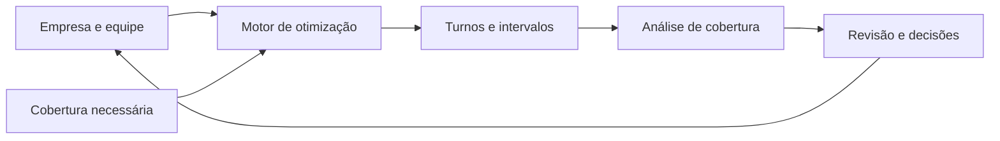

# EscalaLivre

### Planeje a equipe. Enxergue as lacunas. Tome decisões melhores.

**EscalaLivre é uma plataforma aberta de planejamento de equipes que combina geração automática de escalas, análise de cobertura e regras configuráveis em uma interface pensada para RH e pequenos empresários.**

**Sem IA generativa: a geração de escalas usa matemática, algoritmos e otimização por restrições. Não depende de modelos de linguagem nem de serviços de IA.**

**Para usar uma instância já disponibilizada, basta abrir no navegador: sem cadastro e sem instalar nada no seu dispositivo. Salve seu progresso e continue de onde parou quando quiser.**

Uma escala precisa responder a mais do que “quem trabalha hoje?”. É preciso saber se haverá pessoas suficientes na abertura, durante o almoço e no fechamento — sem ignorar disponibilidade, descanso e limites de jornada.

O EscalaLivre conecta essas perguntas. Você informa como a empresa funciona, quem faz parte da equipe e quantas pessoas precisa em cada período. O sistema busca uma distribuição de turnos, mostra o que ficou descoberto e oferece informações para revisar o planejamento.

[Como funciona](#como-funciona) · [Recursos](#o-que-você-pode-fazer-hoje) · [Executar localmente](#experimente-localmente) · [Potencial](#para-onde-o-projeto-pode-crescer)

## O problema que queremos resolver

Montar uma escala manualmente exige conciliar decisões que se afetam o tempo todo:

- Um turno que cobre a abertura pode deixar o fechamento sem atendimento.
- Duas pessoas presentes podem significar apenas uma disponível durante o almoço.
- Uma troca de horário pode resolver uma falta de cobertura e criar um conflito de descanso.
- Uma equipe insuficiente precisa de um diagnóstico útil para orientar ajustes ou contratação.

**O objetivo é tornar essas relações visíveis e reduzir o trabalho de tentativa e erro.** A escala passa a ser um planejamento que pode ser analisado, ajustado e levado de um dispositivo para outro.

## Um exemplo: vendedores todos os dias

Imagine uma loja que precisa de dois vendedores das 9h às 18h, de segunda a sábado.

1. Cadastre o funcionamento da loja e as pessoas da equipe.
2. Crie uma regra de cobertura para **Vendedor**, selecione os seis dias e informe o horário e a quantidade mínima.
3. Configure jornadas, disponibilidades e restrições individuais.
4. Abra o **Assistente de escala** e gere o planejamento.
5. Confira os turnos, os intervalos e os períodos em que ainda faltam pessoas.

O motor considera alternativas de início de turno e de intervalo. Se a equipe não consegue atender toda a demanda, ele pode retornar uma escala parcial com as lacunas identificadas, preservando as restrições obrigatórias do modelo.

Isso ajuda a responder perguntas práticas: **o problema está nos horários, nos intervalos ou na quantidade de pessoas disponíveis?**

## Como funciona



O núcleo usa **Google OR-Tools CP-SAT**, um motor de otimização por restrições. Ele avalia combinações de turnos e intervalos para reduzir a falta de cobertura, respeitando as regras representadas no modelo.

A busca prioriza reduzir lacunas de cobertura, depois penaliza turnos adicionais e considera pesos de preferência. O resultado inclui turnos, conflitos, cobertura por período, sugestões e explicações baseadas nas regras avaliadas.

A execução possui limite de tempo e pode encontrar uma solução viável sem comprovar que ela é a melhor possível. A interface permite revisar o resultado e continuar ajustando o planejamento.

## O que você pode fazer hoje

| Recurso | Utilidade no dia a dia |
| --- | --- |
| **Configuração da empresa** | Definir horários, dias de funcionamento, jornada padrão, descanso e intervalos. |
| **Cadastro da equipe** | Gerenciar funções, regras individuais, disponibilidade e restrições de horário. |
| **Cobertura em vários dias** | Aplicar a mesma necessidade a dias selecionados, a todos os dias ou aos dias de funcionamento. |
| **Geração automática** | Buscar turnos e intervalos que atendam à operação dentro das restrições do modelo. |
| **Análise durante a edição** | Recalcular localmente a cobertura e os conflitos quando o planejamento muda. |
| **Escala diária, semanal e mensal** | Visualizar horários por pessoa e navegar pelo calendário. |
| **Ajustes pelo calendário** | Arrastar turnos para mudar horários e conferir o efeito no planejamento. |
| **Pessoas por horário** | Comparar quantas pessoas estão escaladas com quantas são necessárias por função e período. |
| **Onde faltam pessoas** | Identificar lacunas por função e dia em uma visualização com cores. |
| **Assistente de escala** | Revisar conflitos, explicações dos turnos e sugestões de ajuste e contratação. |
| **Arquivo `.escalalivre`** | Exportar e reabrir empresa, equipe, regras e turnos em um documento portátil. |
| **Temas claro e escuro** | Usar a interface em português, com explicações das abas e contraste adaptado ao tema. |

O backend também oferece exportação XLSX e uma exportação PDF básica pela API. Os controles de importação e exportação da interface usam o formato nativo `.escalalivre`.

## Por que a proposta é diferente

### Matemática aplicada ao planejamento

O “Assistente de escala” é uma interface para o motor de otimização, não um chatbot. As decisões são calculadas a partir dos dados, das restrições e da função objetivo definidos no sistema, usando OR-Tools CP-SAT. Os diagnósticos e as explicações são produzidos por regras e algoritmos implementados no projeto.

Isso permite examinar o modelo, testar suas regras e entender quais critérios orientam o planejamento. O ganho vem de avaliar combinações de horários de forma sistemática, sem depender de respostas de um modelo de linguagem.

### Cobertura real, considerando os intervalos

A presença de alguém na escala não significa que essa pessoa esteja disponível durante todo o turno. O cálculo desconta os intervalos para revelar faltas de cobertura que uma lista de horários pode esconder.

### Um resultado útil mesmo quando faltam pessoas

Quando não é possível cobrir toda a operação com a equipe disponível, uma escala parcial e suas lacunas ajudam a orientar a próxima decisão. As sugestões de contratação estimam horas e janelas de necessidade a partir dos períodos descobertos.

### Regras compartilhadas, exceções individuais

A empresa define padrões, e cada pessoa pode herdá-los ou ter uma jornada própria. O domínio possui regimes configuráveis em dias e em horas, permitindo evoluir as regras sem prender a arquitetura a um único formato de escala.

### Comece sem cadastro e retome quando quiser

O usuário acessa a interface pelo navegador, sem criar conta, baixar aplicativo ou instalar programas. As instruções de instalação deste README são para quem quer executar ou desenvolver sua própria instância do projeto.

O planejamento é salvo automaticamente no navegador para continuar no mesmo dispositivo. Para guardar uma cópia ou retomar em outro computador, clique em **Exportar** e salve o arquivo `.escalalivre`. Depois, use **Importar** para recuperar a empresa, a equipe, as regras e os turnos e continuar de onde parou.

### Dados locais e portáteis

O uso local não exige conta nem banco de dados. O planejamento fica salvo no navegador e pode ser exportado para um arquivo que reúne o contexto completo da escala.

**A edição e a análise local funcionam sem consultar a API; a geração automática precisa do backend em execução.** Ao gerar a escala, o documento é enviado à API configurada. O armazenamento no navegador depende daquele dispositivo e pode ser apagado com os dados do site; o arquivo nativo permite manter uma cópia independente.

### Uma base aberta para novas soluções

Frontend, API, domínio e infraestrutura estão separados. Essa estrutura permite evoluir a experiência de uso, adicionar regimes e desenvolver integrações sobre o mesmo núcleo de planejamento.

## Para quem

- **Pequenos empresários:** organizar a equipe e enxergar onde a operação precisa de reforço.
- **Profissionais de RH:** reunir regras e restrições em um planejamento que possa ser revisado.
- **Gestores de operação:** acompanhar a cobertura por função, horário e dia.
- **Desenvolvedores:** construir novas experiências e integrações sobre uma API e um domínio abertos.

Lojas, equipes de atendimento e operações com horários recorrentes são exemplos de aplicação da proposta. Cada contexto exige configurar e validar as regras adequadas à sua operação.

## Experimente localmente

### Pré-requisitos

- Node.js 22 ou compatível com as dependências do frontend, com npm.
- .NET SDK 10. O arquivo `global.json` referencia `10.0.201` e permite avanço para uma feature band posterior da mesma versão principal.
- Git para clonar o repositório.

```bash
git clone https://github.com/argemon/escalalivre.git
cd escalalivre
```

Em um terminal, inicie a API:

```bash
dotnet restore backend/EscalaLivre.Api/EscalaLivre.Api.csproj
dotnet run --project backend/EscalaLivre.Api/EscalaLivre.Api.csproj --launch-profile http
```

Em outro terminal, inicie o frontend:

```bash
cd frontend
npm ci
npm run dev
```

Abra [http://localhost:5173](http://localhost:5173). A interface inicia com dados de demonstração para explorar os fluxos. A API usa [http://localhost:5003](http://localhost:5003), com verificação de disponibilidade em `/health`.

Para usar outra API, crie `frontend/.env.local`:

```dotenv
VITE_API_URL=http://localhost:5003
```

Reinicie o Vite após mudar essa configuração. Para testar com seus próprios dados, configure a empresa, ajuste a equipe e cadastre a cobertura mínima antes de gerar a escala.

## Arquitetura e tecnologias

| Camada | Responsabilidade | Tecnologias |
| --- | --- | --- |
| Frontend | Interface, edição, persistência e análise local | React 19, TypeScript, Vite, TailwindCSS, Zustand, TanStack Query, FullCalendar e Zod |
| API | Receber documentos, validar requisições e expor o planejamento | .NET 10, ASP.NET Core Minimal APIs e FluentValidation |
| Domínio e aplicação | Representar jornadas, pessoas, turnos, regras e contratos | C# e abstrações de regimes e planejamento |
| Infraestrutura | Otimização e importação/exportação | Google OR-Tools CP-SAT e serialização de documentos |

```text
frontend/
  src/components/                Interface de planejamento
  src/lib/                       Análise local, regras e cliente da API
  src/store/                     Estado e persistência no navegador
  tests/                         Regressões da análise de cobertura
backend/
  EscalaLivre.Domain/            Modelos e regimes de jornada
  EscalaLivre.Application/       Contratos e interfaces de serviços
  EscalaLivre.Infrastructure/    Solver e importação/exportação
  EscalaLivre.Api/               Endpoints HTTP
  EscalaLivre.Tests/             Testes do backend
docs/                           Documentação técnica
```

## API

| Endpoint | Função |
| --- | --- |
| `POST /solve` | Gerar uma escala e retornar a análise do resultado. |
| `POST /validate` | Verificar o planejamento enviado. |
| `POST /analyze` | Analisar os turnos existentes, sem gerar uma nova escala. |
| `POST /import` | Ler um documento no formato nativo. |
| `POST /export` | Exportar em formato nativo, XLSX ou PDF básico. |
| `GET /health` | Verificar se a API está disponível. |

As operações de planejamento recebem um documento e um período. As respostas dessas operações usam um envelope com `success`, `data`, `errors`, `warnings` e `metadata`. Exemplos de chamadas estão em [EscalaLivre.Api.http](backend/EscalaLivre.Api/EscalaLivre.Api.http).

## Qualidade e validação

O projeto inclui testes para situações como lacunas durante o almoço, turnos que atravessam a meia-noite, descanso entre jornadas, cobertura parcial e horários de início que atendem ao fechamento.

Na raiz do repositório:

```bash
node --test frontend/tests/planning.test.cjs
dotnet test backend/EscalaLivre.Tests/EscalaLivre.Tests.csproj --configuration Release
```

No diretório `frontend`:

```bash
npm run lint
npm run build
```

O GitHub Actions executa lint e compilação do frontend, além de compilação e testes do backend.

## Para onde o projeto pode crescer

A base atual permite explorar uma visão maior: **apoiar decisões sobre capacidade da equipe antes que a falta de cobertura se torne um problema na operação.**

As direções abaixo são possibilidades de evolução, ainda não recursos completos do produto:

| Direção | Valor esperado |
| --- | --- |
| Comparação de cenários | Avaliar o efeito de contratar, mudar horários ou ampliar o funcionamento. |
| Histórico de versões | Comparar planejamentos e acompanhar a evolução da cobertura. |
| Colaboração e sincronização opcionais | Compartilhar a revisão entre gestores e RH. |
| PWA e experiência móvel | Facilitar instalação e consulta da escala em diferentes dispositivos. |
| Integrações com planilhas, ponto e sistemas de RH | Reduzir cadastro repetido e conectar planejamento à operação. |
| Novos regimes e regras específicas | Ampliar a aplicação a diferentes jornadas e contextos. |

## Estado atual

O EscalaLivre está em desenvolvimento, com cadastro, análise local, geração de escalas e portabilidade já implementados. O motor trabalha com candidatos discretos de turnos e intervalos e com as regras atualmente modeladas; a extensão de regimes e a evolução das exportações são áreas abertas a contribuição.

A validação cobre regras implementadas, como descanso e limite semanal. Ela não representa uma certificação de conformidade com toda a legislação ou com convenções coletivas. As sugestões de contratação derivam das lacunas de cobertura e precisam ser avaliadas no contexto da empresa.

## Documentação e contribuição

- [Arquitetura](docs/architecture.md)
- [Motor de otimização](docs/solver.md)
- [Regras de negócio](docs/business-rules.md)
- [Regimes de jornada](docs/regimes.md)
- [Importação e exportação](docs/import-export.md)

Contribuições podem melhorar a interface, os testes, a documentação, os regimes e o motor de planejamento. Para propor uma mudança, descreva o problema e um exemplo de uso em uma issue. Em pull requests, explique o comportamento esperado e execute as verificações relevantes.

## Licença

Distribuído sob a [licença MIT](LICENSE).
