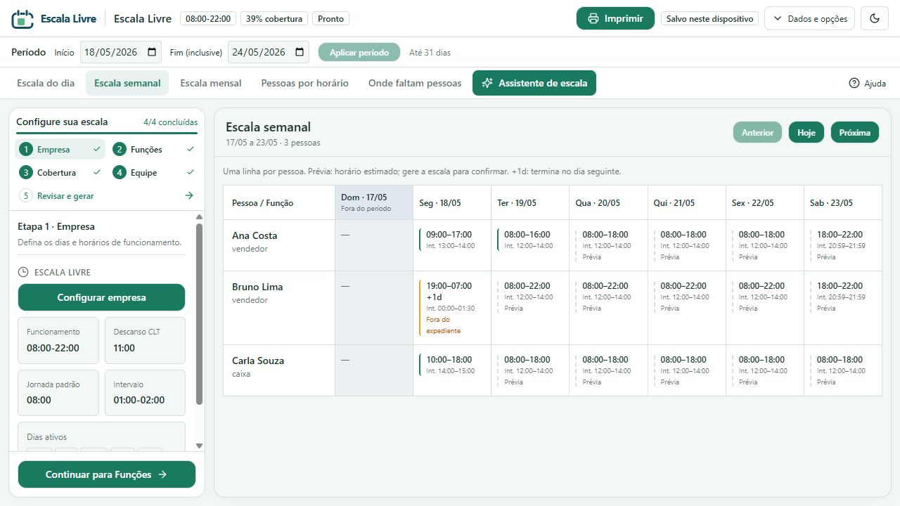
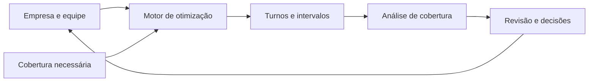

# Escala Livre


### Planeje a equipe. Enxergue as lacunas. Tome decisões melhores.

**Escala Livre é uma plataforma aberta para montar escalas de trabalho, conferir a cobertura da operação e ajustar jornadas, intervalos e disponibilidades. Feita para RH, gestores e pequenos empresários.**

> **Matemática para organizar pessoas.** A geração de escalas usa algoritmos e otimização por restrições, sem IA generativa, modelos de linguagem ou serviços de IA.

A interface funciona no navegador, **sem cadastro**. O planejamento fica no dispositivo e pode ser levado para outro computador em um arquivo `.escalalivre`. A hospedagem pública ainda não está definida; para experimentar, veja [como executar localmente](#experimente-localmente) e as [proteções da API](docs/SECURITY.md).

Uma escala precisa responder a mais do que “quem trabalha hoje?”. É preciso saber se haverá pessoas suficientes na abertura, durante o almoço e no fechamento — sem ignorar disponibilidade, descanso e limites de jornada.

O EscalaLivre conecta essas perguntas. Você informa como a empresa funciona, quem faz parte da equipe e quantas pessoas precisa em cada período. O sistema busca uma distribuição de turnos, mostra o que ficou descoberto e oferece informações para revisar o planejamento.

[Primeiros passos](#primeiros-passos) · [Recursos](#o-que-você-pode-fazer-hoje) · [Período e geração](#período-de-planejamento-e-geração) · [Salvar e recuperar](#salvar-exportar-e-recuperar) · [Executar localmente](#experimente-localmente) · [Algoritmo por dentro](#para-os-nerds-o-algoritmo-por-dentro)



*Exemplo com dados de demonstração. A tabela distingue horários estimados de turnos salvos.*

## O problema que queremos resolver

Montar uma escala manualmente exige conciliar decisões que se afetam o tempo todo:

- Um turno que cobre a abertura pode deixar o fechamento sem atendimento.
- Duas pessoas presentes podem significar apenas uma disponível durante o almoço.
- Uma troca de horário pode resolver uma falta de cobertura e criar um conflito de descanso.
- Uma equipe insuficiente precisa de um diagnóstico útil para orientar ajustes ou contratação.

**O objetivo é tornar essas relações visíveis e reduzir o trabalho de tentativa e erro.** A escala passa a ser um planejamento que pode ser analisado, ajustado e levado de um dispositivo para outro.

## Primeiros passos

Na lateral **Configure sua escala**, preencha os quatro cadastros na ordem indicada. Os números, as marcações de conclusão e o contador ajudam a acompanhar o progresso; o botão **Continuar** leva à próxima etapa.

| Etapa | O que preencher |
| --- | --- |
| **1. Empresa** | Nome, dias e horários de funcionamento, jornada padrão, descanso e intervalos. |
| **2. Funções** | Os cargos usados na operação e quais outras funções cada um pode cobrir. |
| **3. Cobertura** | Quantas pessoas são necessárias em cada função, dia e faixa de horário. |
| **4. Equipe** | Pessoas, funções, mínimo contratado, máximo semanal com extras e eventuais disponibilidades ou restrições individuais. |

Depois dos cadastros:

1. No cabeçalho, escolha **Início** e **Fim (inclusive)** e clique em **Aplicar período**.
2. Abra o botão verde **Assistente de escala**, com o ícone de brilho, e clique em **Gerar escala**. A etapa **5. Revisar e gerar** também abre o assistente quando os quatro cadastros estão completos.
3. Revise a proposta e suas inclusões, alterações e remoções. Clique em **Aplicar proposta de geração** para confirmar ou rejeite para manter a escala atual. Depois confira cobertura, carga incompleta e conflitos no resumo operacional.
4. Consulte a escala diária, semanal ou mensal. Na semana, cada pessoa aparece uma única vez, com os horários nas colunas dos dias.
5. Edite e fixe os combinados, registre ausências e confira substituições quando necessário. Use **Fechar e divulgar** para guardar uma versão e baixar PDF, PNG ou XLSX; **Dados e opções → Exportar** guarda o arquivo completo `.escalalivre`.

**O Assistente de escala é onde a geração acontece.** As prévias exibidas antes da geração são estimativas dos cadastros; não confirmam jornada, folgas ou descanso. Para gerar, é necessário ter pessoas cadastradas e ao menos uma regra de cobertura com quantidade maior que zero, além da API disponível.

## Um exemplo: vendedores todos os dias

Imagine uma loja que precisa de dois vendedores das 9h às 18h, de segunda a sábado.

1. Em **Empresa**, configure o funcionamento da loja; em **Funções**, cadastre **Vendedor**.
2. Em **Cobertura**, crie uma regra para **Vendedor**, selecione os seis dias e informe o horário e a quantidade mínima de duas pessoas.
3. Em **Equipe**, cadastre as pessoas e configure jornadas, disponibilidades e restrições individuais.
4. Aplique o período desejado e use **Assistente de escala → Gerar escala**.
5. Confira os turnos, os intervalos, os feriados e os períodos em que ainda faltam pessoas.

**Exemplo de jornada:** oito horas de trabalho com uma hora de intervalo ocupam nove horas no relógio. Das 9h às 18h, com pausa das 12h às 13h, a pessoa trabalha oito horas — e fica fora da cobertura durante a pausa.

O motor considera alternativas de início de turno e de intervalo. Se a equipe não consegue atender toda a demanda, ele pode retornar uma escala parcial com as lacunas identificadas, preservando as restrições obrigatórias do modelo, inclusive o mínimo contratado devido. Se esse mínimo não couber nas disponibilidades e demais limites, a geração informa o impedimento e preserva os turnos anteriores.

Isso ajuda a responder perguntas práticas: **o problema está nos horários, nos intervalos ou na quantidade de pessoas disponíveis?**

## Como funciona



O núcleo usa **Google OR-Tools CP-SAT**, um motor de otimização por restrições. Ele avalia combinações de turnos e intervalos para reduzir a falta de cobertura, respeitando as regras representadas no modelo.

A busca começa pelo intervalo mínimo efetivo. Uma pausa maior pode viabilizar o mínimo contratado ou reduzir as lacunas de cobertura. Entre alternativas ampliadas, o motor prioriza cobertura, menor ampliação total dos intervalos, carga normal contratada quando configurada e preferências. O resultado inclui turnos, conflitos, cobertura por período, saldos diários e semanais quando há plano, sugestões e explicações baseadas nas regras avaliadas. Os detalhes estão na [seção técnica](#para-os-nerds-o-algoritmo-por-dentro).

A execução possui limite de tempo e pode encontrar uma solução viável sem comprovar que ela é a melhor possível. A interface permite revisar o resultado e continuar ajustando o planejamento.

## O que você pode fazer hoje

| Recurso | Utilidade no dia a dia |
| --- | --- |
| **Configuração da empresa** | Definir funcionamento, horas efetivas de trabalho, descanso, limites de intervalo e fechamento para almoço. |
| **Cadastro de equipe** | Cadastrar com campos essenciais, duplicar modelos, editar campos selecionados em lote e importar CSV/XLSX com prévia e confirmação. |
| **Funções, vigências e inativação** | Registrar mudanças a partir de uma data, revisar adequações futuras e preservar o histórico dos turnos. |
| **Mínimo contratado e máximo semanal** | Exigir a carga normal devida na geração, mesmo com pessoas além do mínimo de cobertura, e separar o teto total com extras autorizadas. |
| **Escala individual 5x2 e 6x1** | Escolher dias e folgas automáticos ou fixos por pessoa; no 5x2 de 42h, optar por 8h24 diárias ou 8h com aviso das 2h faltantes. |
| **Saída antecipada e horas faltantes** | Ajustar a saída de turnos salvos e conferir o saldo por dia e semana, sem reduzir automaticamente a carga contratada. |
| **Cobertura exclusiva e acumulação** | Definir o mínimo de pessoas por função e permitir acumulação explícita, com aviso dos períodos em que a mesma pessoa cobre várias funções. |
| **Ausências e substituições** | Registrar férias, atestados, licenças ou indisponibilidades, conferir turnos atingidos e procurar substitutos elegíveis. |
| **Cobertura em vários dias** | Aplicar a mesma necessidade a dias selecionados, a todos os dias ou aos dias de funcionamento. |
| **Cobertura da equipe inteira** | Exigir uma quantidade mínima de pessoas presentes, independentemente da função. |
| **Operação fora do expediente** | Autorizar necessidades específicas em outros horários ou dias, como segurança e limpeza. |
| **Intervalos flexíveis ou fixos** | Priorizar a pausa mínima, ampliar somente para reduzir lacunas de cobertura ou respeitar o intervalo fixo de uma pessoa. |
| **Feriados e turnos especiais** | Configurar abertura ou fechamento por data e manter turnos específicos mesmo com a empresa fechada. |
| **Geração com revisão** | Gerar o período ou um recorte, preservar turnos fixados e aplicar somente uma proposta confirmada. |
| **Edição e desfazer/refazer** | Criar, editar e remover turnos com prévia do impacto, precisão de segundos e histórico de operações da sessão. |
| **Cópia e troca de turnos** | Copiar uma semana, resolver colisões e conferir a troca completa de responsáveis antes de aplicar. |
| **Fila e tempo de espera** | Acompanhar a posição real, os pedidos à frente, a estimativa de espera e o tempo decorrido até receber a escala. |
| **Cancelamento de geração** | Cancelar um pedido na fila ou em processamento, mantendo os turnos atuais. |
| **Análise durante a edição** | Recalcular localmente a cobertura e os conflitos quando o planejamento muda. |
| **Escala diária, semanal e mensal** | Consultar horários; na semana, comparar os dias em uma tabela com uma linha por pessoa, sem repetir nomes. |
| **Período de planejamento** | Definir de 1 a 31 dias, com datas inclusivas, para consulta, análise e geração. |
| **Ajustes nas três visualizações** | Abrir o editor do turno salvo no dia, na semana ou no mês; arrastar no mês abre uma proposta para revisão. |
| **Pessoas por horário** | Comparar quantas pessoas estão escaladas com quantas são necessárias por função e período. |
| **Onde faltam pessoas** | Identificar lacunas por função e dia em uma visualização com cores. |
| **Resumo operacional com ações** | Separar conflitos obrigatórios, falta de pessoas, carga incompleta e avisos; navegar ao contexto e conferir ações possíveis. |
| **Arquivo `.escalalivre`** | Exportar e reabrir empresa, equipe, regras, período e turnos em um documento portátil. |
| **Cópias e recuperação** | Baixar ou restaurar cópias anteriores e recuperar dados quando o armazenamento apresenta falhas. |
| **Fechamento e divulgação** | Guardar versões independentes por período e exportar PDF paginado, PNG em páginas ou XLSX, para equipe ou pessoa. |
| **Temas claro e escuro** | Usar a interface em português, com explicações das abas e contraste adaptado ao tema. |

O formato `.escalalivre` guarda o documento completo, incluindo versões fechadas. O painel **Fechar e divulgar** prepara saídas para a equipe; PDF/XLSX usam o serviço de exportação, e PNG é gerado no navegador.

## Período de planejamento e geração

O período do cabeçalho vale para as visualizações, a análise de cobertura e o Assistente de escala. Escolha de **1 a 31 dias**, incluindo as datas de início e fim, e clique em **Aplicar período**. Navegar entre semanas ou meses não altera esse período.

Ao aplicar uma geração, o sistema substitui os turnos **pela data em que começam**:

- Turnos **fixados** permanecem integralmente, com pessoa, horários e pausa. Turnos livres que começam dentro do período ou recorte podem ser substituídos por inteiro, mesmo que terminem no dia seguinte.
- Turnos que começam antes ou depois são preservados e considerados nas regras de descanso, jornada e cobertura.
- A geração apresenta uma proposta com inclusões, alterações e remoções, sem aplicá-la automaticamente. Rejeitar ou cancelar mantém a escala; falha ou resposta sem solução viável também preserva os turnos. Uma solução com lacunas pode ser revisada e confirmada.

Por exemplo, gerar de **19/10 a 21/10** pode substituir um turno livre iniciado às 22h de 21/10 e encerrado às 6h de 22/10. Um turno iniciado às 22h de 18/10 e qualquer turno fixado permanecem intactos. O recorte de geração deve estar dentro do período selecionado.

Antes de importar um documento ou aplicar uma geração, a aplicação cria uma cópia recuperável do planejamento anterior. Os detalhes estão em [preservação de turnos](docs/generation-preservation.md) e [período de planejamento](docs/planning-period.md).

### Fila, estimativa de tempo e cancelamento

Ao clicar em **Gerar escala**, o pedido entra na fila do servidor. O Assistente de escala mostra a **posição real na fila**, a quantidade de pedidos à frente, a **estimativa de espera** e o **tempo já decorrido**. Quando chega sua vez, o indicador muda para **Processando sua escala**. O cabeçalho também informa se o pedido está aguardando ou em processamento.

Os tempos são **aproximados**, calculados a partir das gerações recentes, e podem mudar conforme o planejamento e a carga do servidor. Se o processamento superar a estimativa, a interface avisa e continua acompanhando o pedido. A estimativa não representa um prazo garantido nem um percentual de conclusão.

- **Cancelar geração:** retira o pedido da fila ou solicita a interrupção do cálculo em andamento, sem substituir os turnos atuais.
- **Consultar outras abas do app:** mantém a geração em acompanhamento e impede o envio de outro pedido enquanto ela estiver ativa.
- **Falha temporária de conexão:** o app tenta consultar novamente o mesmo pedido, sem reenviar o planejamento; a posição exibida fica identificada como a última confirmada.
- **Alterações durante a espera:** um resultado antigo não sobrescreve o planejamento alterado; a interface orienta a gerar novamente com os dados atuais.

O Escala Livre é gratuito e usa uma fila para economizar recursos de hospedagem. Na configuração padrão, atende **um cálculo por vez, com até 20 pedidos aguardando**. Se a fila estiver cheia, o app informa que é preciso aguardar e tentar novamente. A espera na fila é separada do limite de tempo de cada cálculo; planos mais complexos continuam sujeitos aos limites do gerador.

**Mantenha esta página aberta durante a espera.** Recarregar ou fechar a página não recupera o acompanhamento do pedido, embora ele possa terminar no servidor. A fila fica em memória: se o servidor reiniciar, pedidos pendentes e resultados são perdidos e será necessário gerar novamente. Consulte os [detalhes da fila de processamento](docs/processing-queue.md).

## Salvar, exportar e recuperar

O salvamento é automático no navegador. **Salvo neste dispositivo** indica que a gravação foi confirmada; um aviso de armazenamento exige atenção. Dados locais dependem do navegador e do dispositivo usados e podem ser removidos ao limpar os dados do site.

No menu **Dados e opções**, no cabeçalho:

| Ação | Quando usar |
| --- | --- |
| **Exportar** | Baixar empresa, equipe, regras, turnos e versões fechadas em `.escalalivre` para arquivar ou continuar em outro dispositivo. |
| **Importar** | Abrir um arquivo `.escalalivre` e confirmar a substituição do planejamento atual e de suas versões. |
| **Cópias e recuperação de dados** | Baixar ou restaurar cópias anteriores, exportar os dados disponíveis ou tentar salvar novamente após uma falha. |
| **Limpar tudo** | Apagar o planejamento atual após digitar a confirmação solicitada. Exporte antes o que deseja guardar. |

São mantidas até **três cópias de planejamento** para recuperação, além dos conteúdos preservados em falhas. Se não for possível confirmar a cópia anterior, a importação ou aplicação da geração é bloqueada para proteger o documento atual. Arquivos nativos têm limite de **1 MiB**; downloads brutos de recuperação em `.json` podem precisar de reparo antes de serem usados como planejamento.

**Edição, análise local, PNG e importação/exportação nativa funcionam sem consultar a API. A geração automática e as saídas PDF/XLSX precisam do backend.** Ao gerar, o documento é enviado à API configurada. Consulte [recuperação de dados](docs/recovery.md) para o comportamento em falhas.

## Recursos em detalhe

### Cadastro, histórico e ajustes do dia a dia

O cadastro começa pelos dados essenciais; configurações individuais ficam nos detalhes. É possível duplicar um modelo, escolher quais campos aplicar em lote ou importar CSV/XLSX com prévia por linha. Homônimos, erros e itens excluídos exigem revisão antes de aplicar. Duplicar um modelo não replica ausências nem outros eventos datados. Veja o [formato de importação da equipe](docs/team-import.md).

Mudanças de função podem ter uma **data de vigência** e uma opção explícita de adequar os turnos futuros. Turnos anteriores são preservados. Inativar uma pessoa impede novas alocações a partir da data escolhida e mantém os turnos existentes para revisão.

Abra um turno salvo na escala diária, semanal ou mensal para conferir pessoa, função, entrada, saída, pausa e fixação. A alteração é aplicada somente após revisar seu impacto. Conflitos obrigatórios exigem ciência explícita para manter um rascunho; isso não torna a escala pronta para fechamento. **Desfazer/Refazer** guarda até 20 operações, sujeito à cota de memória da sessão; recarregar, importar ou recuperar um documento reinicia esse histórico. Versões fechadas não são apagadas por desfazer.

Em **Ausências e substituições**, registre categoria, datas e eventuais dispensas explícitas por dia. A categoria, sozinha, não concede crédito de horas. Confira os turnos atingidos e escolha manter, remover ou substituir; um turno fixado precisa ser desafixado antes de uma substituição. A proposta inteira é reavaliada, e a busca pode informar que não há candidato elegível.

Use **Copiar semana / trocar turnos** para copiar de domingo a sábado ou trocar responsáveis por dois turnos. A cópia cria novos IDs e permite escolher se leva a fixação; ausências e versões fechadas não são copiadas. Colisões exigem uma escolha explícita. A troca é aplicada por inteiro e exige que os dois participantes fiquem sem conflitos obrigatórios. Veja [edição e histórico](docs/planning-edits.md), [ausências e substituições](docs/decisions/027-absence-events-and-substitution.md) e [cópia e troca](docs/schedule-reuse.md).

O **resumo operacional** organiza conflitos obrigatórios, falta de pessoas, carga incompleta e avisos. Os filtros e ações levam ao dia, pessoa, turno ou demanda correspondente. Alocação e substituição mostram uma proposta antes de confirmar; a busca é local e não garante encontrar todas as alternativas possíveis. Consulte [resumo e ações](docs/operational-summary.md).

### Mínimo contratado, máximo semanal e horas faltantes

Em **Equipe**, abra o funcionário. Ele pode herdar o padrão da empresa ou ter uma configuração própria. Em **Escala do funcionário**, escolha **5x2**, **6x1** ou **Ciclo personalizado**. A escolha de 5x2/6x1 mantém a carga existente; quando ainda não há contrato, sugere 40h/44h para revisão. Cada funcionário pode ter sua própria carga, como 20h, 30h, 40h ou 42h. Documentos antigos continuam sem mínimo inferido ao abrir.

Com **Deixar o programa escolher os dias de trabalho e as folgas**, a carga é distribuída entre os dias que o gerador selecionar junto com os horários. Uma empresa aberta sete dias pode ter pessoas em 5x2 com folgas diferentes: abrir todos os dias não obriga cada funcionário a trabalhar todos eles. O ciclo considera também o histórico fora do período. Desmarque a opção para informar dias fixos permitidos e confira a distribuição da carga nesses dias. As folgas não precisam ser sábado e domingo nem consecutivas; se as restrições impedirem completar a carga devida, a geração informa o impedimento e mantém o planejamento anterior.

| Campo | Significado |
| --- | --- |
| **Mínimo semanal — jornada contratada** | Trabalho normal exigido na geração para a semana completa, sem contar pausas ou horas extras e respeitando as dispensas e exceções explícitas. Nos dias fixos, a distribuição define cada meta; no automático, a escala define os dias que receberão a carga. |
| **Máximo semanal, incluindo extras** | Teto de trabalho líquido de domingo a sábado, incluindo extras autorizadas e turnos preservados. Não é uma meta nem uma autorização de extras por si só. |
| **Permitir hora extra** | Autorização individual, separada da compensação semanal. Limites diários, descanso e demais regras continuam valendo. |

Por exemplo, **mínimo 40h e máximo 48h** mantêm 40h de jornada normal prevista. As horas além do contrato exigem autorização de extras e precisam caber nos limites aplicáveis; configurar 48h no máximo não obriga a trabalhar 48h. Sem autorização de extras, o teto normal continua limitado a até 44h semanais. A compensação semanal possui instrumento e vigência próprios; permitir extras não a substitui.

Para ajustar um dia, abra **Ajustar saída dos turnos salvos**, altere a saída e clique em **Salvar saída manual**. Esse botão salva imediatamente, independentemente das alterações cadastrais ainda não salvas. Entrada e intervalo são preservados; a saída precisa manter a pausa dentro do turno.

**Exemplo:** em um contrato de 40h distribuídas em cinco dias de 8h, com entrada às 07:30 e intervalo das 12h às 13h, mudar a saída de segunda de 16:30 para 15:30 deixa **39h planejadas e 1h faltante**. A falta aparece no dia da escala semanal e no relatório do Assistente de escala. Esse é um saldo do planejamento, sem apuração de ponto, desconto salarial ou banco de horas automático. Extras em outro dia não quitam a falta automaticamente.

No plano de dias fixos, feriados fechados e dispensas explicitamente registradas reduzem a meta do dia. Na escolha automática, um feriado não tem dia contratual previamente definido: o fechamento impede turnos, mas a dispensa de carga precisa ser registrada quando aplicável. Bloqueios ou saída antecipada, sozinhos, não concedem crédito. A empresa abrir menos dias também não apaga o contrato.

No automático, horas ainda sem turno aparecem como **Carga ainda sem dia definido**, incluídas no saldo semanal, sem marcar cada possível folga como falta diária. Períodos parciais reservam as cotas cabíveis após o histórico salvo. O gerador precisa cumprir o mínimo devido mesmo quando a cobertura já está atendida: pode acrescentar pessoas da mesma função dentro do funcionamento e das disponibilidades. A API também admite geração contratada sem demanda; a interface continua exigindo ao menos uma regra positiva de cobertura para iniciar. Se não houver solução compatível com o contrato, preserva os turnos anteriores. Edições manuais continuam permitidas e mostram o saldo faltante.

**Mudanças da legislação:** a EC 141/2026 prevê a transição para dois repousos semanais, 42h normais após dois meses da publicação de 16/10/2026 e 40h um ano depois desse prazo. O cadastro e a análise avisam quando o período planejado alcança a transição e exige revisão de escala/carga. Não convertem contratos nem aplicam exceções coletivas automaticamente. O [registro da pesquisa e da implementação](docs/decisions/020-individual-weekly-patterns.md) explica os prazos do texto oficial e os limites desses avisos.

Ao salvar e reabrir, carga, distribuição, dispensas e horários são preservados. Use uma versão atualizada para editar arquivos com esses recursos: leitores antigos podem ignorar os novos campos ou rejeitar tetos acima de 44h. Consulte o [contrato de mínimo, máximo e saída antecipada](docs/decisions/019-contract-minimum-and-overtime-ceiling.md) e a [exigência do mínimo na geração](docs/decisions/029-contract-minimum-generation.md).

### 42h semanais em 5x2

No plano de 42h em cinco dias, escolha a jornada diária explicitamente:

| Opção | Resultado na semana completa |
| --- | --- |
| **8h24 por dia** | 42h de trabalho normal, sem contar intervalos. |
| **8h por dia** | 40h normais e aviso de **2h faltantes**, com sugestão de ajustar para 8h24. Essa é uma exceção explícita ao mínimo exigido pelo gerador. |

O restante pode ser planejado como hora extra quando houver autorização e margem nos limites, mas extras são contabilizadas separadamente e não apagam automaticamente o saldo normal faltante. O gerador não cria essas extras automaticamente. A escolha fica salva no arquivo; abrir um documento antigo não seleciona uma opção nem altera a jornada.

### Intervalo e fechamento são coisas diferentes

A empresa pode fechar durante o almoço. Nesse período, as regras normais deixam de exigir atendimento. Quem tem um turno atravessando esse fechamento faz uma pausa que cobre o período fechado.

Uma pessoa que precisa continuar trabalhando, como um segurança, pode receber a opção **Trabalha durante o fechamento para intervalo** e fazer sua pausa em outro horário. Regras excepcionais de cobertura continuam podendo exigir pessoas durante o fechamento.

Sem intervalo fixo, o motor começa pela menor duração compatível com o mínimo da empresa, a jornada e o fechamento para almoço. Pausas maiores podem viabilizar o mínimo contratado quando a tentativa inicial não encontra solução. Quando já há solução viável, só a substituem se reduzirem a falta de cobertura; apenas transferir um buraco para outro horário não justifica ampliar o intervalo. Quando precisa ampliar, prioriza a menor ampliação total encontrada. Se duas pausas de uma hora atendem toda a demanda, mantém uma hora para ambas. Intervalos fixos e rotinas já ancoradas pelo histórico são respeitados. A prévia também usa o mínimo efetivo; a escolha conjunta dos horários acontece na geração.

### Uma pessoa pode ajudar em outra função — com autorização

Na cobertura, informe o **Mínimo de pessoas nesta função** para cada cargo e período; a necessidade da equipe inteira é configurada separadamente. Na etapa **Funções**, defina quais outras funções cada cargo pode cobrir. **Substituições individuais** acrescenta permissões por pessoa; a autorização é direcional e não se encadeia automaticamente. Farmacêutico → Atendente não autoriza o contrário, e Gerente → Caixa junto com Caixa → Vendedor não autoriza Gerente → Vendedor.

Documentos novos usam **cobertura exclusiva**: uma pessoa é distribuída entre as funções autorizadas e conta em uma delas por vez. Sem autorização explícita de acumulação, precisar de um farmacêutico e um atendente exige duas pessoas, mesmo que uma possa exercer as duas funções. Na necessidade de equipe inteira, cada pessoa conta uma vez. Durante a pausa, não fornece cobertura.

Em **Funções que pode ocupar ao mesmo tempo**, ative **Pode cobrir duas ou mais funções ao mesmo tempo** e selecione pelo menos duas funções autorizadas. A **acumulação explícita** permite configurar um grupo de funções simultâneas por pessoa. Enquanto o grupo estiver ativo, somente seus membros autorizados contribuem; as demais permissões não são alocadas até revisar ou desativar o grupo. Há um grupo ativo por pessoa, sem escolha automática entre vários grupos alternativos.

A análise avisa quando uma pessoa efetivamente atende mínimos de várias funções ao mesmo tempo, indicando nome, funções, data e horário. Um farmacêutico autorizado pode atender o mínimo de um farmacêutico e um atendente simultaneamente. Se forem necessários dois atendentes, ainda falta outro atendente. Na equipe inteira ele continua contando uma vez; a pausa interrompe sua contribuição e o aviso.

Arquivos antigos sem o modo exclusivo mantêm a contagem simultânea legada. A interface permite conferir uma prévia e confirmar a conversão. Consulte a [decisão sobre cobertura exclusiva](docs/decisions/025-exclusive-role-allocation.md).

### Feriado fechado, segurança escalada

Na visão mensal, clique no número de um dia ou em **Adicionar feriado**. Informe o nome, escolha se a empresa estará aberta e adicione, edite ou remova turnos específicos.

Com a empresa fechada, o gerador não cria turnos regulares nessa data. Os turnos autorizados no editor de feriado são mantidos na geração, inclusive quando terminam no dia seguinte. Descanso, disponibilidade, intervalos e limites de jornada continuam sendo conferidos; uma exceção de funcionamento não elimina as outras regras.

O calendário inclui uma lista de feriados nacionais de data fixa e permite configurar datas locais. Datas móveis e demais datas específicas da operação precisam ser cadastradas.

### Calendário mais fácil de ler

A **escala semanal** mostra uma linha por pessoa e uma coluna por dia, com entrada, saída e intervalo. Dias fora do período ficam identificados; **Sem turno** indica ausência de turno ou prévia naquele dia, sem confirmar folga. Clique no nome para abrir o cadastro; clique no horário salvo para editar o turno.

A **escala mensal** apresenta cartões por dia, com pessoa, função, entrada, saída, intervalo e situação. Ambas as visões também exibem horários estimados a partir dos cadastros. No mês:

| Indicação | Como interpretar |
| --- | --- |
| **Prévia** | Estimativa baseada na configuração; ainda não é um turno salvo nem uma solução do otimizador. |
| **Salvo** | Turno cadastrado ou gerado, incluído no planejamento. |
| **Feriado · Fechada/Aberta** | Exceção de funcionamento configurada para a data. |
| **Fundo verde no dia** | Destaque da data de hoje. |

Os cabeçalhos dos dias permanecem visíveis durante a rolagem. As visualizações resumem horários como **07:30**; o editor e as exportações preservam segundos. **+1d** indica que o turno termina no dia seguinte. No calendário mensal, arrastar um turno salvo abre a alteração para revisão; prévias servem para consulta.

### Feche uma versão e divulgue a escala

Clique em **Fechar e divulgar** e escolha o rascunho ou uma versão fechada. O fechamento guarda uma cópia independente com identidade, número, período, instante, nomes, funções, turnos e pausas. Alterar o cadastro ou a escala depois disso não muda a versão entregue. Refazer o fechamento cria outra versão; a versão vigente é escolhida para cada período, preservando as anteriores. Em períodos sobrepostos, selecione explicitamente qual versão deseja divulgar.

Conflitos obrigatórios detectados, inclusive no histórico, bloqueiam o fechamento. Lacunas, carga incompleta, avisos e preferências exigem reconhecimento explícito por categoria. A versão guarda somente contagens dessas pendências, sem motivos privados. Fechar não equivale a assinatura digital ou proteção contra edição externa do arquivo.

Escolha **Equipe completa** ou uma pessoa e baixe **PDF**, **PNG (páginas em ZIP)** ou **XLSX**. As saídas incluem empresa, período, versão, horários com segundos, pausas e legenda. O rascunho recebe a marca **RASCUNHO**. O PDF usa A4 horizontal paginado, o PNG é dividido em imagens legíveis e o XLSX exporta texto seguro, sem fórmulas geradas a partir dos nomes. Ausências, anotações internas e detalhes pessoais desnecessários ficam fora da divulgação.

A data e hora de fechamento são apresentadas conforme o PC de quem usa o sistema, sem imprimir a localização do horário. Os horários já registrados nos turnos são mantidos.

São permitidas até **10 versões**, com **1.000 turnos e 200 pessoas por versão**, **256 KiB por versão** e **512 KiB no conjunto**, dentro do limite nativo de **1 MiB**. PNG tem limite de **200 páginas/64 MiB**. Ao atingir uma cota, reduza o período ou exporte/arquive e inicie outro documento; versões não são apagadas automaticamente para liberar espaço. Consulte o [contrato de fechamento e divulgação](docs/decisions/028-publication-snapshots.md).

## Por que a proposta é diferente

### Matemática aplicada ao planejamento

O “Assistente de escala” é uma interface para o motor de otimização, não um chatbot. As decisões são calculadas a partir dos dados, das restrições e da função objetivo definidos no sistema, usando OR-Tools CP-SAT. Os diagnósticos e as explicações são produzidos por regras e algoritmos implementados no projeto.

Isso permite examinar o modelo, testar suas regras e entender quais critérios orientam o planejamento. O ganho vem de avaliar combinações de horários de forma sistemática, sem depender de respostas de um modelo de linguagem.

### Cobertura real, considerando os intervalos

A presença de alguém na escala não significa que essa pessoa esteja disponível durante todo o turno. O cálculo desconta os intervalos para revelar faltas de cobertura que uma lista de horários pode esconder.

### Um resultado útil mesmo quando faltam pessoas

Quando não é possível cobrir toda a operação com a equipe disponível, uma escala parcial e suas lacunas ajudam a orientar a próxima decisão. As sugestões de contratação estimam horas e janelas de necessidade a partir dos períodos descobertos.

### Regras compartilhadas, exceções individuais

A empresa define padrões, e cada pessoa pode herdá-los ou ter uma jornada própria. O domínio possui regimes configuráveis em dias e em horas, permitindo evoluir as regras sem prender a arquitetura a um único formato de escala.

### Uma base aberta para novas soluções

Frontend, API, domínio e infraestrutura estão separados. Essa estrutura permite evoluir a experiência de uso, adicionar regimes e desenvolver integrações sobre o mesmo núcleo de planejamento.

## Para quem

- **Pequenos empresários:** organizar a equipe e enxergar onde a operação precisa de reforço.
- **Profissionais de RH:** reunir regras e restrições em um planejamento que possa ser revisado.
- **Gestores de operação:** acompanhar a cobertura por função, horário e dia.
- **Desenvolvedores:** construir novas experiências e integrações sobre uma API e um domínio abertos.

Lojas, equipes de atendimento e operações com horários recorrentes são exemplos de aplicação da proposta. Cada contexto exige configurar e validar as regras adequadas à sua operação.

## Para os nerds: o algoritmo por dentro

O ponto interessante é que **turno, intervalo e função coberta participam da mesma decisão**. Uma pausa que melhora o fechamento pode piorar o atendimento no meio do dia. Uma pessoa polivalente pode ser mais útil protegendo a função que ninguém mais consegue exercer. O modelo compara essas relações em conjunto.

### 1. Construir possibilidades antes de escolher

Para cada pessoa e dia, o motor constrói candidatos que combinam entrada, saída e intervalo. Ele considera funcionamento, janelas excepcionais de cobertura, jornada herdada ou individual, entrada fixa, disponibilidade e restrições.

- Entradas variáveis são exploradas em passos de **30 minutos**, incluindo alternativas de abertura, fechamento e início de disponibilidade. Quando há entrada fixa, ela restringe essa busca.
- Durações de intervalo incluem os limites configurados e alternativas em passos de **15 minutos**.
- Inícios de pausa incluem passos de **30 minutos**, limites viáveis e o horário preferido. Um intervalo fixo substitui essa busca.
- A jornada preserva **precisão de segundos civis**: duração total menos pausa. Com plano contratado, as durações candidatas seguem a distribuição do dia e consideram o saldo semanal disponível após o histórico.
- Com dias automáticos, os candidatos podem ocorrer em qualquer dia elegível. O modelo escolhe quais datas usar, respeitando o ciclo, a carga semanal e os segundos restantes da divisão entre dias.

Candidatos incompatíveis são descartados antes da otimização. A implementação verifica, entre outras condições, trabalho noturno autorizado, limites diários e intervalo dentro do turno. O fechamento para almoço e a autorização de trabalho durante ele também afetam as pausas possíveis.

Isso torna o problema finito: o solver escolhe entre candidatos construídos pelo código. A melhor solução nesse conjunto pode ser diferente da melhor solução entre todos os horários imagináveis.

### 2. Transformar o calendário em blocos precisos

A demanda usa uma malha de referência de uma hora, subdividida nos pontos em que algo muda: início ou fim de regra, turno, intervalo ou fechamento. Assim, uma pausa às **12:30** cria uma fronteira própria; o cálculo não arredonda a falta de cobertura para a hora inteira.

Uma pessoa cobre um bloco somente se trabalha durante **todo** ele e não está em intervalo. Regras sobrepostas para a mesma função e escopo usam o maior mínimo exigido naquele trecho, evitando somar a mesma necessidade repetida. Fechamentos e feriados fechados retiram a demanda regular correspondente.

### 3. Escolher turnos e distribuir pessoas sem duplicá-las

Cada candidato `c` recebe uma variável binária `x[c]`: **1** seleciona o turno; **0** o descarta. O modelo limita cada pessoa a um turno por dia, impede combinações sem descanso suficiente e restringe trabalho semanal e ciclos em dias. O histórico nas duas bordas do período consome o teto semanal; turnos noturnos e pausas são repartidos na virada da semana. No ciclo em dias, turnos anteriores ao período também reduzem a capacidade disponível nas janelas que os alcançam.

Para cada bloco, a presença de uma pessoa é o OR dos seus turnos que cobrem todo o trecho. Turnos históricos sobrepostos continuam no documento, mas não multiplicam a contagem. No modo exclusivo, variáveis de alocação distribuem cada pessoa presente entre as funções autorizadas:

```text
alocação[p,b,r] ≤ presente[p,b]
Σ funções alocação[p,b,r] ≤ presente[p,b]  (pessoa sem acumulação)
Σ pessoas alocação[p,b,r] + falta[b,r] ≥ mínimo[b,r]
```

Grupos de acumulação ativos permitem contribuições simultâneas somente em seus membros autorizados. A necessidade de equipe inteira usa presença, contando cada pessoa uma vez; pausas não fornecem cobertura. A função exercida registrada no turno e a vigência na data inicial participam da elegibilidade. Documentos legados sem o modo exclusivo conservam o contrato simultâneo até uma conversão confirmada. Veja [alocação exclusiva e regressões](docs/decisions/025-exclusive-role-allocation.md).


O mínimo normal devido é uma restrição obrigatória por pessoa e semana, considerando o histórico, o período parcial e as dispensas explícitas. Candidatos contratados podem ser gerados mesmo em horários sem demanda, dentro do funcionamento. A opção explícita de 42h com cinco dias de 8h exige 40h normais e mantém o aviso de 2h faltantes. Distribuição fixa incompatível ou falta de disponibilidade impede aplicar uma nova escala; não reduz silenciosamente o contrato.

### 4. Otimizar cobertura, duração dos intervalos, carga e preferências

A primeira tentativa admite somente pausas automáticas com a duração mínima efetiva. Se o mínimo contratado não couber nessa tentativa, a busca pode relaxar preferências de intervalo para encontrar uma solução viável. Quando já há solução e ainda existe déficit, uma tentativa com pausas maiores só a substitui quando reduz estritamente a falta de cobertura em ticks × pessoas, sem usar o score arredondado. A antecipação em relação ao horário preferido também exige melhora de cobertura. Empate, falha ou prazo esgotado preservam a solução anterior. Pausas fixas, fechamento, feriados autorizados e rotina histórica mantêm suas regras.

Quando há alternativas acima do intervalo mínimo ou plano contratado efetivo, o CP-SAT aplica objetivos sucessivos:

1. Minimizar déficit de cobertura em segundos × pessoas.
2. Conservar a cobertura e minimizar a ampliação total das pausas automáticas, quando houver essa escolha.
3. Conservar os valores anteriores e maximizar a carga normal reconhecida, limitada à meta de cada dia, quando houver plano contratado.
4. Conservar também a carga encontrada e aplicar preferências, ocupação e desempates.

As fases e tentativas compartilham o orçamento de busca. Uma fase sem prova de ótimo fixa o melhor valor encontrado, sem garantir ótimo global; se uma fase inferior piorar as prioridades anteriores, o resultado anterior é preservado. Não se geram extras automaticamente para preencher a meta. Consulte a [preferência pelo intervalo mínimo](docs/decisions/023-minimum-automatic-interval.md) e o [mínimo obrigatório na geração contratada](docs/decisions/029-contract-minimum-generation.md), que atualiza as limitações anteriores.

**Sem plano contratado e sem alternativas acima do intervalo mínimo**, o CP-SAT mantém uma única função ponderada. Os coeficientes desse modo são:

| Termo | Peso no objetivo | Efeito |
| --- | --- | --- |
| Falta de uma pessoa por minuto de demanda | `−1.000.000.000` | Penalizar fortemente a cobertura insuficiente. |
| Minuto com pelo menos uma pessoa elegível presente em um bloco de demanda | `+10.000` | Favorecer presença distribuída nos períodos necessários. |
| Turno selecionado | `−1.000.000` | Evitar adicionar turnos com pouco benefício para a cobertura. |
| Ajuste por turno | Entre `−1.000` e `+1.000` | Considerar preferências e bônus de fechamento. |
| Desvio do almoço em relação à entrada + pausa preferencial | `−2` por segundo de desvio | Favorecer almoço próximo do horário configurado, inclusive em turnos noturnos. |

Nesse modo, os pesos pertencem a uma soma. Preferências não substituem restrições obrigatórias em nenhum dos modos. A duração dos blocos multiplica os termos de falta e presença, fazendo uma lacuna de 15 minutos pesar menos que uma lacuna igual de uma hora.

O solver está configurado com **limite interno de 5 segundos e 1 trabalhador de busca**. Um resultado `Feasible` é viável; `Optimal` comprova o ótimo das fases do modelo considerado, dentro das condições da tentativa. O limite de tempo pode terminar sem encontrar solução viável, e múltiplas soluções equivalentes podem produzir escalas diferentes.

Turnos preservados fora do período e turnos manuais autorizados de feriado são incluídos como decisões fixas (`x = 1`); candidatos regulares para a mesma pessoa e data são retirados. Se essas decisões entram em conflito com outras restrições, o resultado aponta o problema e mantém esses turnos para revisão.

### 5. Medir e explicar o resultado

Depois da escolha, o motor recalcula conflitos, cobertura, lacunas e sugestões. A pontuação usa **pessoa-minutos**, limitando o crédito ao mínimo exigido em cada bloco:

```text
cobertura = Σ(min(exigido, alocado) × minutos do bloco)
demanda   = Σ(exigido × minutos do bloco)
score     = cobertura / demanda
```

Sem demanda, o score é `1`; o backend arredonda o resultado a três casas decimais. Excesso de pessoas em um horário não compensa uma falta em outro. Quando coexistem mínimos por função e equipe inteira, a pontuação agrega essas exigências.

As explicações são geradas por regras e modelos de texto do projeto. As sugestões de contratação agrupam lacunas por função, com estimativa limitada a 44 horas e até sete janelas no backend; são pistas para revisão, não um segundo solver de contratação nem uma prova da causa de cada decisão.

**Onde ler o código:** [solver CP-SAT](backend/EscalaLivre.Infrastructure/Solver/OrToolsScheduleOptimizer.cs), [política de intervalos](backend/EscalaLivre.Domain/Scheduling/IntervalPolicy.cs), [feriados](backend/EscalaLivre.Domain/Scheduling/LaborRules.cs), [alocação de cobertura no navegador](frontend/src/lib/coverageAllocation.ts) e [análise local](frontend/src/lib/analysis.ts).

## Experimente localmente

### Pré-requisitos

- Node.js 22 ou compatível com as dependências do frontend, com npm.
- .NET SDK 10. O arquivo `global.json` referencia `10.0.201` e permite avanço para uma feature band posterior da mesma versão principal.
- Git para clonar o repositório.

```bash
git clone https://github.com/argemon/escalalivre.git
cd escalalivre
```

Em um terminal, inicie a API:

```bash
dotnet restore backend/EscalaLivre.Api/EscalaLivre.Api.csproj
dotnet run --project backend/EscalaLivre.Api/EscalaLivre.Api.csproj --launch-profile http
```

Em outro terminal, inicie o frontend:

```bash
cd frontend
npm ci
npm run dev
```

Abra [http://localhost:5173](http://localhost:5173). A interface inicia com dados de demonstração para explorar os fluxos. A API usa [http://localhost:5003](http://localhost:5003), com verificação de disponibilidade em `/health`.

Para usar outra API, crie `frontend/.env.local`:

```dotenv
VITE_API_URL=http://localhost:5003
```

Reinicie o Vite após mudar essa configuração. Para testar com seus próprios dados, siga [Primeiros passos](#primeiros-passos). Em produção, sem `VITE_API_URL`, o frontend usa a mesma origem da página; a variável é incorporada ao build.

### Problemas comuns

| Situação | O que conferir |
| --- | --- |
| **Gerar escala** está desabilitado | Cadastre pessoas e ao menos uma regra de cobertura com quantidade maior que zero. |
| A geração não conecta | Verifique a API em `http://localhost:5003/health`, a URL configurada e as origens permitidas no backend. O ambiente de desenvolvimento permite o frontend na porta 5173. |
| O serviço está ocupado ou atingiu o limite | Aguarde o prazo informado antes de tentar novamente. Para hospedar, consulte os limites em [SECURITY.md](docs/SECURITY.md). |
| O cálculo atingiu o tempo limite | Tente um período menor ou simplifique as regras de cobertura, sem retirar restrições obrigatórias da operação. |
| Os horários aparecem como **Prévia** | Abra o Assistente de escala e gere o planejamento; estimativas não são turnos salvos. |
| A impressão não contém os horários esperados | Confira o mês escolhido e se os turnos foram salvos; prévias não entram na impressão. |
| Há aviso de armazenamento | Abra **Dados e opções → Cópias e recuperação de dados**, exporte o conteúdo disponível e confira as opções de recuperação. |

## Arquitetura e tecnologias

| Camada | Responsabilidade | Tecnologias |
| --- | --- | --- |
| Frontend | Interface, edição, persistência e análise local | React 19, TypeScript, Vite, TailwindCSS, Zustand, TanStack Query, FullCalendar e Zod |
| API | Receber documentos, validar requisições e expor o planejamento | .NET 10, ASP.NET Core Minimal APIs e FluentValidation |
| Domínio e aplicação | Representar jornadas, pessoas, turnos, regras e contratos | C# e abstrações de regimes e planejamento |
| Infraestrutura | Otimização e importação/exportação | Google OR-Tools CP-SAT e serialização de documentos |

```text
frontend/
  src/components/                Interface de planejamento
  src/lib/                       Análise local, regras e cliente da API
  src/store/                     Estado e persistência no navegador
  tests/                         Regressões da análise de cobertura
backend/
  EscalaLivre.Domain/            Modelos e regimes de jornada
  EscalaLivre.Application/       Contratos e interfaces de serviços
  EscalaLivre.Infrastructure/    Solver e importação/exportação
  EscalaLivre.Api/               Endpoints HTTP
  EscalaLivre.Analysis.Tests/    Testes puros de domínio e aplicação
  EscalaLivre.Adapter.Tests/     Adaptadores e OR-Tools real
  EscalaLivre.Api.Tests/         Composição e fila
  EscalaLivre.Architecture.Tests/ Dependências e superfície pública
docs/                           Documentação técnica
```

## API

| Endpoint | Função |
| --- | --- |
| `POST /solve` | Gerar uma escala e retornar a análise do resultado. |
| `POST /solve/jobs` | Entrar na fila de geração e receber um token de acompanhamento. |
| `GET /solve/jobs/{id}` | Consultar posição, estimativa, estado e resultado do pedido. |
| `DELETE /solve/jobs/{id}` | Cancelar um pedido de geração. |
| `POST /validate` | Verificar o planejamento enviado. |
| `POST /analyze` | Analisar os turnos existentes, sem gerar uma nova escala. |
| `POST /import` | Ler um documento no formato nativo. |
| `POST /export` | Exportar em formato nativo, XLSX ou PDF paginado; saídas de divulgação usam a projeção da versão escolhida. |
| `GET /health` | Verificar se a API está disponível. |

As operações `/solve`, `/validate` e `/analyze` recebem um documento e um período. As respostas dessas operações usam um envelope com `success`, `data`, `errors`, `warnings` e `metadata`. Em desenvolvimento, o contrato OpenAPI está disponível em [http://localhost:5003/openapi/v1.json](http://localhost:5003/openapi/v1.json). `GET /health` retorna um objeto simples com o estado do serviço.

A interface usa a geração assíncrona: `POST /solve/jobs` recebe documento e período e retorna **HTTP 202** com um token de acompanhamento. `GET /solve/jobs/{id}` informa o estado, a posição e as estimativas, incluindo o resultado quando concluído; `DELETE /solve/jobs/{id}` solicita o cancelamento. O endpoint síncrono `/solve` continua disponível por compatibilidade. Para publicar este recurso, atualize **frontend e backend juntos**; a configuração da fila está em [fila de geração](docs/processing-queue.md).

## Qualidade e validação

O projeto inclui testes de cobertura, intervalos, descanso, turnos noturnos, substituições autorizadas, feriados, impressão, período de planejamento, datas e horários, recuperação, preservação de turnos e segurança. As suítes separam domínio/aplicação puros, adaptadores com OR-Tools real, API e arquitetura.

A comparação diferencial entre C# e TypeScript usa cenários determinísticos para conferir diagnósticos, cobertura, lacunas, pontuação e saldos diários e semanais de carga contratada, além de propriedades de imutabilidade, migração e preservação de histórico. Os testes incluem saída antecipada, dispensas explícitas e teto semanal com e sem autorização de extras. A autorização por IDs explícitos prevalece sobre nomes legados, inclusive quando uma autorização é revogada.

Na raiz do repositório:

```bash
node --test frontend/tests/*.test.cjs
dotnet test backend/EscalaLivre.Analysis.Tests/EscalaLivre.Analysis.Tests.csproj -c Release
dotnet test backend/EscalaLivre.Adapter.Tests/EscalaLivre.Adapter.Tests.csproj -c Release
dotnet test backend/EscalaLivre.Api.Tests/EscalaLivre.Api.Tests.csproj -c Release
dotnet test backend/EscalaLivre.Architecture.Tests/EscalaLivre.Architecture.Tests.csproj -c Release

node tools/parity-differential.cjs
```

No diretório `frontend`:

```bash
npm run lint
npm run build
```

Para o teste de integração de segurança, compile a API em Debug e execute na raiz do repositório:

```bash
dotnet build backend/EscalaLivre.Api/EscalaLivre.Api.csproj
node backend/security.integration.cjs
```

O script inicia sua própria API de teste e verifica as proteções HTTP. Para usar uma compilação em Release, defina `SECURITY_BUILD_CONFIGURATION=Release` no ambiente.

O GitHub Actions executa lint, compilação e testes do frontend, além de compilação da API, testes do backend, arquitetura e integração de segurança em Release. A comparação diferencial e os testes do frontend são executados em duas configurações de relógio do dispositivo; a paridade participa da validação obrigatória do backend.

As ferramentas em `tools/performance-*.cjs` medem fases de análise/geração, memória, modelo e HTTP com fila/worker. O workflow manual **Performance evidence** coleta medições; os limites locais geram alertas e não são tratados como metas universais de produção. A leitura de cobertura indexa turnos por pessoa para evitar varreduras repetidas do histórico. Consulte a [metodologia e os resultados](docs/decisions/012-current-performance.md) antes de interpretar ganhos.

## Para onde o projeto pode crescer

A base atual permite explorar uma visão maior: **apoiar decisões sobre capacidade da equipe antes que a falta de cobertura se torne um problema na operação.**

As direções abaixo são possibilidades de evolução, ainda não recursos completos do produto:

| Direção | Valor esperado |
| --- | --- |
| Comparação de cenários | Avaliar o efeito de contratar, mudar horários ou ampliar o funcionamento. |
| Comparação entre versões | Ampliar a consulta das versões fechadas com comparação detalhada de mudanças e cobertura. |
| Colaboração e sincronização opcionais | Compartilhar a revisão entre gestores e RH. |
| PWA e experiência móvel | Facilitar instalação e consulta da escala em diferentes dispositivos. |
| Integrações com planilhas, ponto e sistemas de RH | Reduzir cadastro repetido e conectar planejamento à operação. |
| Novos regimes e regras específicas | Ampliar a aplicação a diferentes jornadas e contextos. |

## Estado atual

O EscalaLivre está em desenvolvimento, com cadastro/importação de equipe, histórico de vigências, cobertura exclusiva, geração com proposta, edição/desfazer, ausências/substituições, cópia/troca de turnos, resumo com ações e fechamento/exportação de versões implementados. O domínio contém tipos validados e operações protegidas de planejamento; análise e validação usam um avaliador comum, separado da otimização. Os regimes declaram capacidades de trabalho, descanso e ciclo, mantendo os tipos públicos `dayBased` e `hourBased`.

O motor trabalha com candidatos discretos de turnos e intervalos e com as regras atualmente modeladas. A geração é reavaliada antes de aplicar o resultado, preservando os dados anteriores em falhas. A preparação para produção ainda exige validação da versão publicada na hospedagem escolhida, configuração de HTTPS/proxy/recursos e acompanhamento operacional. A fila atual pertence a uma única instância e perde pedidos/resultados ao reiniciar; os arquivos e as cópias locais continuam sob responsabilidade do dispositivo do usuário.

As proteções de publicação incluem cota de geração compartilhada entre `/solve`
e `/solve/jobs`, selecionada pelo endpoint resolvido, e cotas independentes por IP
para consultas e cancelamentos. A fila separa espera, execução e retenção: reserva
até 4 MiB por pedido ativo dentro de um orçamento padrão de 128 MiB de payload,
retém resultados por dois minutos e limita os tickets em memória a 1.024. Esse
orçamento não representa o consumo total de RAM da API e dos processos filhos.

O frontend usa Zod 4.6.7 e verifica os limites das coleções antes de migrar os
documentos, inclusive os recuperados do navegador. Documentos locais válidos
maiores que o limite de 1 MiB dos arquivos nativos continuam recuperáveis. A
[validação das nove tarefas operacionais](docs/tasks/operacao/VALIDACAO-FINAL.md) registra os testes locais, rechecagens focadas, fluxos no Edge e inspeção de PDF/PNG/XLSX. A CI executa a matriz da revisão enviada antes da integração. O [parecer de publicação](review/PARECER-PUBLICACAO.md) registra o contexto das proteções e as condições de hospedagem; resultados históricos não substituem a validação da revisão atual.

A validação cobre regras implementadas, como descanso e limite semanal. Ela não representa uma certificação de conformidade com toda a legislação ou com convenções coletivas. As sugestões de contratação derivam das lacunas de cobertura e precisam ser avaliadas no contexto da empresa.

## Documentação e contribuição

- [Arquitetura](docs/architecture.md)
- [Instruções de desenvolvimento: SOLID e DDD](AGENTS.md)
- [Plano de evolução arquitetural](docs/architecture-improvement-plan.md)
- [Motor de otimização](docs/solver.md)
- [Regras de negócio](docs/business-rules.md)
- [Regimes de jornada](docs/regimes.md)
- [Importação e exportação](docs/import-export.md)
- [Período de planejamento](docs/planning-period.md)
- [Geração e preservação de turnos](docs/generation-preservation.md)
- [Salvamento e recuperação](docs/recovery.md)
- [Datas e horários](docs/date-time.md)
- [Regras compartilhadas entre frontend e backend](docs/rule-parity.md)
- [Guia de testes e validação](docs/testing.md)
- [Extensibilidade dos regimes](docs/decisions/010-regime-extension-boundaries.md)
- [Paridade diferencial e correção de autorização](docs/decisions/011-deterministic-rule-parity.md)
- [Desempenho: metodologia, resultados e limites](docs/decisions/012-current-performance.md)
- [Segurança e publicação da API](docs/SECURITY.md)
- [Parecer final das correções de publicação](review/PARECER-PUBLICACAO.md)
- [Cotas HTTP por endpoint e IP](docs/decisions/013-http-rate-limits.md)
- [Orçamento e retenção da fila](docs/decisions/014-job-retention-budget.md)
- [Zod, auditorias e validação segura de documentos](docs/decisions/015-zod-validation-security.md)
- [Configuração da carga contratada e distribuição diária](docs/decisions/017-weekly-workload-configuration.md)
- [Geração e diagnóstico da carga contratada](docs/decisions/018-weekly-workload-generation.md)
- [Mínimo contratado, máximo com extras e saída antecipada](docs/decisions/019-contract-minimum-and-overtime-ceiling.md)
- [Escala individual 5x2/6x1 e dias escolhidos pelo gerador](docs/decisions/020-individual-weekly-patterns.md)
- [Cobertura simultânea legada por função autorizada](docs/decisions/021-simultaneous-authorized-coverage.md)
- [Autorizações herdadas da função](docs/decisions/022-role-coverage-grants.md)
- [Preferência pelo intervalo automático mínimo](docs/decisions/023-minimum-automatic-interval.md)
- [Cadastro e importação de equipe](docs/team-import.md)
- [Histórico de função e inativação](docs/decisions/024-employment-history.md)
- [Cobertura exclusiva e acumulação explícita](docs/decisions/025-exclusive-role-allocation.md)
- [Edição direta e desfazer](docs/planning-edits.md)
- [Fixação e propostas de geração](docs/decisions/026-pinned-generation-proposals.md)
- [Ausências e substituições](docs/decisions/027-absence-events-and-substitution.md)
- [Cópia de semana e troca de turnos](docs/schedule-reuse.md)
- [Resumo operacional e ações](docs/operational-summary.md)
- [Fechamento e divulgação](docs/decisions/028-publication-snapshots.md)
- [Plano operacional e evidências das nove tarefas](docs/tasks/operacao/00-EXECUTAR-PROXIMA-TASK.md)
- [Fila, estimativas e cancelamento de geração](docs/processing-queue.md)
- [Identidade visual](docs/brand.md)

Contribuições podem melhorar a interface, os testes, a documentação, os regimes e o motor de planejamento. Para propor uma mudança, descreva o problema e um exemplo de uso em uma issue. Em pull requests, explique o comportamento esperado e execute as verificações relevantes.

## Licença

Distribuído sob a [licença MIT](LICENSE).

Validação por fronteira, integração HTTP e fuso alternativo: [guia de testes](docs/testing.md). Revisão das seis dimensões e limitações reais: [relatório final](docs/decisions/stage-6-final-review.md).
