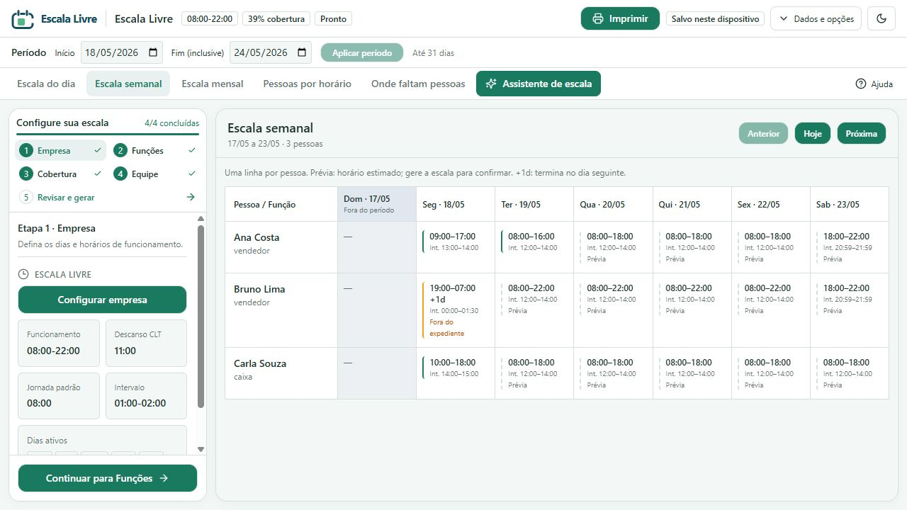
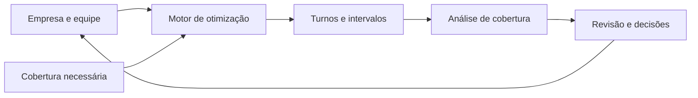

# Escala Livre


### Planeje a equipe. Enxergue as lacunas. Tome decisões melhores.

**Escala Livre é uma plataforma aberta para montar escalas de trabalho, conferir a cobertura da operação e ajustar jornadas, intervalos e disponibilidades. Feita para RH, gestores e pequenos empresários.**

> **Matemática para organizar pessoas.** A geração de escalas usa algoritmos e otimização por restrições, sem IA generativa, modelos de linguagem ou serviços de IA.

Use uma instância já disponibilizada pelo navegador, **sem cadastro nem instalação**. O planejamento fica no dispositivo e pode ser levado para outro computador em um arquivo `.escalalivre`. Para hospedar sua própria instância, veja [como executar localmente](#experimente-localmente) e as [proteções da API](docs/SECURITY.md).

Uma escala precisa responder a mais do que “quem trabalha hoje?”. É preciso saber se haverá pessoas suficientes na abertura, durante o almoço e no fechamento — sem ignorar disponibilidade, descanso e limites de jornada.

O EscalaLivre conecta essas perguntas. Você informa como a empresa funciona, quem faz parte da equipe e quantas pessoas precisa em cada período. O sistema busca uma distribuição de turnos, mostra o que ficou descoberto e oferece informações para revisar o planejamento.

[Primeiros passos](#primeiros-passos) · [Recursos](#o-que-você-pode-fazer-hoje) · [Período e geração](#período-de-planejamento-e-geração) · [Salvar e recuperar](#salvar-exportar-e-recuperar) · [Executar localmente](#experimente-localmente) · [Algoritmo por dentro](#para-os-nerds-o-algoritmo-por-dentro)



*Exemplo com dados de demonstração. A tabela distingue horários estimados de turnos salvos.*

## O problema que queremos resolver

Montar uma escala manualmente exige conciliar decisões que se afetam o tempo todo:

- Um turno que cobre a abertura pode deixar o fechamento sem atendimento.
- Duas pessoas presentes podem significar apenas uma disponível durante o almoço.
- Uma troca de horário pode resolver uma falta de cobertura e criar um conflito de descanso.
- Uma equipe insuficiente precisa de um diagnóstico útil para orientar ajustes ou contratação.

**O objetivo é tornar essas relações visíveis e reduzir o trabalho de tentativa e erro.** A escala passa a ser um planejamento que pode ser analisado, ajustado e levado de um dispositivo para outro.

## Primeiros passos

Na lateral **Configure sua escala**, preencha os quatro cadastros na ordem indicada. Os números, as marcações de conclusão e o contador ajudam a acompanhar o progresso; o botão **Continuar** leva à próxima etapa.

| Etapa | O que preencher |
| --- | --- |
| **1. Empresa** | Nome, dias e horários de funcionamento, jornada padrão, descanso e intervalos. |
| **2. Funções** | Os cargos usados na operação, como Vendedor, Caixa ou Segurança. |
| **3. Cobertura** | Quantas pessoas são necessárias em cada função, dia e faixa de horário. |
| **4. Equipe** | Pessoas, funções, jornadas e eventuais disponibilidades ou restrições individuais. |

Depois dos cadastros:

1. No cabeçalho, escolha **Início** e **Fim (inclusive)** e clique em **Aplicar período**.
2. Abra o botão verde **Assistente de escala**, com o ícone de brilho, e clique em **Gerar escala otimizada**. A etapa **5. Revisar e gerar** também abre o assistente quando os quatro cadastros estão completos.
3. Revise a cobertura atendida, os conflitos e as sugestões. Uma escala parcial pode ter horários válidos e ainda deixar demanda descoberta.
4. Consulte a escala diária, semanal ou mensal. Na semana, cada pessoa aparece uma única vez, com os horários nas colunas dos dias.
5. Use **Dados e opções → Exportar** para guardar uma cópia ou **Imprimir** para preparar a escala para o mural.

**O Assistente de escala é onde a geração acontece.** As prévias exibidas antes da geração são estimativas dos cadastros; não confirmam jornada, folgas ou descanso. Para gerar, é necessário ter pessoas cadastradas e ao menos uma regra de cobertura com quantidade maior que zero, além da API disponível.

## Um exemplo: vendedores todos os dias

Imagine uma loja que precisa de dois vendedores das 9h às 18h, de segunda a sábado.

1. Em **Empresa**, configure o funcionamento da loja; em **Funções**, cadastre **Vendedor**.
2. Em **Cobertura**, crie uma regra para **Vendedor**, selecione os seis dias e informe o horário e a quantidade mínima de duas pessoas.
3. Em **Equipe**, cadastre as pessoas e configure jornadas, disponibilidades e restrições individuais.
4. Aplique o período desejado e use **Assistente de escala → Gerar escala otimizada**.
5. Confira os turnos, os intervalos, os feriados e os períodos em que ainda faltam pessoas.

**Exemplo de jornada:** oito horas de trabalho com uma hora de intervalo ocupam nove horas no relógio. Das 9h às 18h, com pausa das 12h às 13h, a pessoa trabalha oito horas — e fica fora da cobertura durante a pausa.

O motor considera alternativas de início de turno e de intervalo. Se a equipe não consegue atender toda a demanda, ele pode retornar uma escala parcial com as lacunas identificadas, preservando as restrições obrigatórias do modelo.

Isso ajuda a responder perguntas práticas: **o problema está nos horários, nos intervalos ou na quantidade de pessoas disponíveis?**

## Como funciona



O núcleo usa **Google OR-Tools CP-SAT**, um motor de otimização por restrições. Ele avalia combinações de turnos e intervalos para reduzir a falta de cobertura, respeitando as regras representadas no modelo.

A busca combina pesos para reduzir lacunas, favorecer presença nos períodos de demanda, evitar turnos adicionais e considerar preferências. O resultado inclui turnos, conflitos, cobertura por período, sugestões e explicações baseadas nas regras avaliadas. Os detalhes e os pesos estão na [seção técnica](#para-os-nerds-o-algoritmo-por-dentro).

A execução possui limite de tempo e pode encontrar uma solução viável sem comprovar que ela é a melhor possível. A interface permite revisar o resultado e continuar ajustando o planejamento.

## O que você pode fazer hoje

| Recurso | Utilidade no dia a dia |
| --- | --- |
| **Configuração da empresa** | Definir funcionamento, horas efetivas de trabalho, descanso, limites de intervalo e fechamento para almoço. |
| **Funções e equipe** | Cadastrar funções e definir, por pessoa, jornada, dias de trabalho, entrada fixa, disponibilidade e restrições. |
| **Substituições autorizadas** | Informar quais outras funções cada pessoa pode cobrir, sem contar a mesma pessoa duas vezes no mesmo horário. |
| **Cobertura em vários dias** | Aplicar a mesma necessidade a dias selecionados, a todos os dias ou aos dias de funcionamento. |
| **Cobertura da equipe inteira** | Exigir uma quantidade mínima de pessoas presentes, independentemente da função. |
| **Operação fora do expediente** | Autorizar necessidades específicas em outros horários ou dias, como segurança e limpeza. |
| **Intervalos flexíveis ou fixos** | Deixar o gerador escolher início e duração da pausa, ou fixar o intervalo de uma pessoa. |
| **Feriados e turnos especiais** | Configurar abertura ou fechamento por data e manter turnos específicos mesmo com a empresa fechada. |
| **Geração automática** | Buscar turnos e intervalos que atendam à operação dentro das restrições do modelo. |
| **Análise durante a edição** | Recalcular localmente a cobertura e os conflitos quando o planejamento muda. |
| **Escala diária, semanal e mensal** | Consultar horários; na semana, comparar os dias em uma tabela com uma linha por pessoa, sem repetir nomes. |
| **Período de planejamento** | Definir de 1 a 31 dias, com datas inclusivas, para consulta, análise e geração. |
| **Ajustes pelo calendário mensal** | Arrastar turnos salvos e conferir o efeito no planejamento; na semana, clicar no nome ou horário para abrir o cadastro da pessoa. |
| **Pessoas por horário** | Comparar quantas pessoas estão escaladas com quantas são necessárias por função e período. |
| **Onde faltam pessoas** | Identificar lacunas por função e dia em uma visualização com cores. |
| **Assistente de escala** | Gerar a escala otimizada e revisar cobertura, conflitos, explicações e sugestões de ajuste e contratação. |
| **Arquivo `.escalalivre`** | Exportar e reabrir empresa, equipe, regras, período e turnos em um documento portátil. |
| **Cópias e recuperação** | Baixar ou restaurar cópias anteriores e recuperar dados quando o armazenamento apresenta falhas. |
| **Impressão para o mural** | Escolher um mês e imprimir os turnos salvos, com empresa em destaque, datas e marca Escala Livre discreta. |
| **Temas claro e escuro** | Usar a interface em português, com explicações das abas e contraste adaptado ao tema. |

O backend também oferece exportação XLSX e uma exportação PDF básica pela API. Os controles de importação e exportação da interface usam o formato nativo `.escalalivre`.

## Período de planejamento e geração

O período do cabeçalho vale para as visualizações, a análise de cobertura e o Assistente de escala. Escolha de **1 a 31 dias**, incluindo as datas de início e fim, e clique em **Aplicar período**. Navegar entre semanas ou meses não altera esse período.

Ao aplicar uma geração, o sistema substitui os turnos **pela data em que começam**:

- Um turno que começa dentro do período é substituído por inteiro, mesmo que termine no dia seguinte ao fim do período.
- Turnos que começam antes ou depois são preservados e considerados nas regras de descanso, jornada e cobertura.
- Uma geração inviável, uma falha ou um tempo limite sem solução viável mantém os turnos atuais. Uma solução parcial com lacunas pode ser aplicada.

Por exemplo, gerar de **19/10 a 21/10** substitui um turno iniciado às 22h de 21/10 e encerrado às 6h de 22/10. Um turno iniciado às 22h de 18/10 permanece intacto.

Antes de importar um documento ou aplicar uma geração, a aplicação cria uma cópia recuperável do planejamento anterior. Os detalhes estão em [preservação de turnos](docs/generation-preservation.md) e [período de planejamento](docs/planning-period.md).

## Salvar, exportar e recuperar

O salvamento é automático no navegador. **Salvo neste dispositivo** indica que a gravação foi confirmada; um aviso de armazenamento exige atenção. Dados locais dependem do navegador e do dispositivo usados e podem ser removidos ao limpar os dados do site.

No menu **Dados e opções**, no cabeçalho:

| Ação | Quando usar |
| --- | --- |
| **Exportar** | Baixar um arquivo `.escalalivre` para guardar uma cópia ou continuar em outro dispositivo. |
| **Importar** | Abrir um arquivo `.escalalivre` e confirmar a substituição do planejamento atual. |
| **Cópias e recuperação de dados** | Baixar ou restaurar cópias anteriores, exportar os dados disponíveis ou tentar salvar novamente após uma falha. |
| **Limpar tudo** | Apagar o planejamento atual após digitar a confirmação solicitada. Exporte antes o que deseja guardar. |

São mantidas até **três cópias de planejamento** para recuperação, além dos conteúdos preservados em falhas. Se não for possível confirmar a cópia anterior, a importação ou aplicação da geração é bloqueada para proteger o documento atual. Arquivos nativos têm limite de **1 MiB**; downloads brutos de recuperação em `.json` podem precisar de reparo antes de serem usados como planejamento.

**Edição, análise local e importação/exportação nativa funcionam sem consultar a API. A geração automática precisa do backend.** Ao gerar, o documento é enviado à API configurada. Consulte [recuperação de dados](docs/recovery.md) para o comportamento em falhas.

## Recursos em detalhe

### Intervalo e fechamento são coisas diferentes

A empresa pode fechar durante o almoço. Nesse período, as regras normais deixam de exigir atendimento. Quem tem um turno atravessando esse fechamento faz uma pausa que cobre o período fechado.

Uma pessoa que precisa continuar trabalhando, como um segurança, pode receber a opção **Trabalha durante o fechamento para intervalo** e fazer sua pausa em outro horário. Regras excepcionais de cobertura continuam podendo exigir pessoas durante o fechamento.

Sem intervalo fixo, o motor compara durações entre o mínimo e o máximo configurados, além de diferentes horários de início. Com intervalo fixo, respeita a pausa individual. Isso permite, por exemplo, avaliar uma pausa maior para alcançar o fechamento da loja sem aumentar as horas efetivamente trabalhadas.

### Uma pessoa pode ajudar em outra função — com autorização

No cadastro, **Substituições autorizadas** define quais outras funções alguém pode cobrir. A autorização tem direção: permitir que um farmacêutico cubra atendimento não autoriza um atendente a cobrir a função de farmacêutico.

Se o mesmo horário exige **um farmacêutico e um atendente**, uma única pessoa habilitada para ambos não resolve as duas necessidades ao mesmo tempo. O sistema distribui as pessoas entre as funções e mostra o que ainda falta. Uma exigência de **equipe inteira** mede o total de pessoas presentes; ela pode coexistir com mínimos por função.

### Feriado fechado, segurança escalada

Na visão mensal, clique no número de um dia ou em **Adicionar feriado**. Informe o nome, escolha se a empresa estará aberta e adicione, edite ou remova turnos específicos.

Com a empresa fechada, o gerador não cria turnos regulares nessa data. Os turnos autorizados no editor de feriado são mantidos na geração, inclusive quando terminam no dia seguinte. Descanso, disponibilidade, intervalos e limites de jornada continuam sendo conferidos; uma exceção de funcionamento não elimina as outras regras.

O calendário inclui uma lista de feriados nacionais de data fixa e permite configurar datas locais. Datas móveis e demais datas específicas da operação precisam ser cadastradas.

### Calendário mais fácil de ler

A **escala semanal** mostra uma linha por pessoa e uma coluna por dia, com entrada, saída e intervalo. Dias fora do período ficam identificados; **Sem turno** indica ausência de turno ou prévia naquele dia, sem confirmar folga. Clique no nome ou horário para abrir o cadastro da pessoa.

A **escala mensal** apresenta cartões por dia, com pessoa, função, entrada, saída, intervalo e situação. Ambas as visões também exibem horários estimados a partir dos cadastros. No mês:

| Indicação | Como interpretar |
| --- | --- |
| **Prévia** | Estimativa baseada na configuração; ainda não é um turno salvo nem uma solução do otimizador. |
| **Salvo** | Turno cadastrado ou gerado, incluído no planejamento. |
| **Feriado · Fechada/Aberta** | Exceção de funcionamento configurada para a data. |
| **Fundo verde no dia** | Destaque da data de hoje. |

Os cabeçalhos dos dias permanecem visíveis durante a rolagem. Horários preservam os minutos, como **07:30**, e os campos usam o formato **HH:mm**. **+1d** indica que o turno termina no dia seguinte. No calendário mensal, turnos salvos podem ser arrastados; prévias servem para consulta.

### Imprima e leve para o mural

Clique em **Imprimir** no cabeçalho e escolha o **mês da escala**. A impressão mostra funcionários em **ordem alfabética**, com colunas para **dias de trabalho**, **entrada e saída** e **intervalo**.

Dias consecutivos com os mesmos horários são agrupados em períodos. Por exemplo: **Edson · 14/10 a 16/10 · 07:30–17:30 · intervalo 11:30–13:30**. Uma mudança de horário ou intervalo, ou um dia sem turno entre duas jornadas, inicia uma nova linha. Todos os funcionários aparecem, incluindo os que não têm turnos salvos no mês.

O nome da empresa aparece em destaque, o período identifica o mês completo e a marca **Escala Livre** fica discreta no canto. O layout usa **A4 horizontal** e continua em outras folhas quando necessário, repetindo o cabeçalho e mantendo o tamanho do texto.

Use **Imprimir / Salvar PDF** para abrir as opções do navegador. Desative os cabeçalhos e rodapés do navegador para retirar o endereço do site. São impressos somente **turnos salvos**, inclusive os especiais de feriado. Dias sem turno salvo não confirmam folga. Os dias se referem à entrada do turno; `+1d` identifica saída ou intervalo no dia seguinte. As prévias estimadas do calendário não entram na impressão.

## Por que a proposta é diferente

### Matemática aplicada ao planejamento

O “Assistente de escala” é uma interface para o motor de otimização, não um chatbot. As decisões são calculadas a partir dos dados, das restrições e da função objetivo definidos no sistema, usando OR-Tools CP-SAT. Os diagnósticos e as explicações são produzidos por regras e algoritmos implementados no projeto.

Isso permite examinar o modelo, testar suas regras e entender quais critérios orientam o planejamento. O ganho vem de avaliar combinações de horários de forma sistemática, sem depender de respostas de um modelo de linguagem.

### Cobertura real, considerando os intervalos

A presença de alguém na escala não significa que essa pessoa esteja disponível durante todo o turno. O cálculo desconta os intervalos para revelar faltas de cobertura que uma lista de horários pode esconder.

### Um resultado útil mesmo quando faltam pessoas

Quando não é possível cobrir toda a operação com a equipe disponível, uma escala parcial e suas lacunas ajudam a orientar a próxima decisão. As sugestões de contratação estimam horas e janelas de necessidade a partir dos períodos descobertos.

### Regras compartilhadas, exceções individuais

A empresa define padrões, e cada pessoa pode herdá-los ou ter uma jornada própria. O domínio possui regimes configuráveis em dias e em horas, permitindo evoluir as regras sem prender a arquitetura a um único formato de escala.

### Uma base aberta para novas soluções

Frontend, API, domínio e infraestrutura estão separados. Essa estrutura permite evoluir a experiência de uso, adicionar regimes e desenvolver integrações sobre o mesmo núcleo de planejamento.

## Para quem

- **Pequenos empresários:** organizar a equipe e enxergar onde a operação precisa de reforço.
- **Profissionais de RH:** reunir regras e restrições em um planejamento que possa ser revisado.
- **Gestores de operação:** acompanhar a cobertura por função, horário e dia.
- **Desenvolvedores:** construir novas experiências e integrações sobre uma API e um domínio abertos.

Lojas, equipes de atendimento e operações com horários recorrentes são exemplos de aplicação da proposta. Cada contexto exige configurar e validar as regras adequadas à sua operação.

## Para os nerds: o algoritmo por dentro

O ponto interessante é que **turno, intervalo e função coberta participam da mesma decisão**. Uma pausa que melhora o fechamento pode piorar o atendimento no meio do dia. Uma pessoa polivalente pode ser mais útil protegendo a função que ninguém mais consegue exercer. O modelo compara essas relações em conjunto.

### 1. Construir possibilidades antes de escolher

Para cada pessoa e dia, o motor constrói candidatos que combinam entrada, saída e intervalo. Ele considera funcionamento, janelas excepcionais de cobertura, jornada herdada ou individual, entrada fixa, disponibilidade e restrições.

- Entradas variáveis são exploradas em passos de **30 minutos**, incluindo alternativas de abertura, fechamento e início de disponibilidade. Quando há entrada fixa, ela restringe essa busca.
- Durações de intervalo incluem os limites configurados e alternativas em passos de **15 minutos**.
- Inícios de pausa incluem passos de **30 minutos**, limites viáveis e o horário preferido. Um intervalo fixo substitui essa busca.
- A jornada é calculada em **minutos efetivamente trabalhados**: duração total menos pausa.

Candidatos incompatíveis são descartados antes da otimização. A implementação verifica, entre outras condições, trabalho noturno autorizado, limites diários e intervalo dentro do turno. O fechamento para almoço e a autorização de trabalho durante ele também afetam as pausas possíveis.

Isso torna o problema finito: o solver escolhe entre candidatos construídos pelo código. A melhor solução nesse conjunto pode ser diferente da melhor solução entre todos os horários imagináveis.

### 2. Transformar o calendário em blocos precisos

A demanda usa uma malha de referência de uma hora, subdividida nos pontos em que algo muda: início ou fim de regra, turno, intervalo ou fechamento. Assim, uma pausa às **12:30** cria uma fronteira própria; o cálculo não arredonda a falta de cobertura para a hora inteira.

Uma pessoa cobre um bloco somente se trabalha durante **todo** ele e não está em intervalo. Regras sobrepostas para a mesma função e escopo usam o maior mínimo exigido naquele trecho, evitando somar a mesma necessidade repetida. Fechamentos e feriados fechados retiram a demanda regular correspondente.

### 3. Escolher turnos e distribuir pessoas sem duplicá-las

Cada candidato `c` recebe uma variável binária `x[c]`: **1** seleciona o turno; **0** o descarta. O modelo limita cada pessoa a um turno por dia, impede combinações sem descanso suficiente e restringe minutos semanais e ciclos em dias. No ciclo em dias, turnos anteriores ao período também reduzem a capacidade disponível nas janelas que os alcançam.

Para cada bloco `b` e função `r`, uma variável binária `y[c,b,r]` representa o uso daquele candidato na cobertura específica. Ela só existe para pessoas habilitadas e obedece a:

```text
y[c,b,r] ≤ x[c]                 só alocar quem foi escalado
Σ por função y[c,b,r] ≤ x[c]    uma pessoa cobre no máximo uma função por bloco
Σ por candidato y[c,b,r] + falta[b,r] ≥ mínimo[b,r]
```

A variável inteira `falta[b,r]` permite devolver cobertura parcial sem transformar toda falta de pessoal em um problema sem solução. Restrições obrigatórias continuam valendo. Para **equipe inteira**, a contagem usa diretamente os turnos presentes, independentemente da função.

Na análise dos turnos existentes, tanto no frontend quanto no backend, a distribuição por função usa **emparelhamento bipartido com caminhos aumentantes**: de um lado estão as pessoas presentes; do outro, as vagas de cobertura. A busca tenta a função principal primeiro e pode realocar uma pessoa para abrir espaço a outra.

```text
Necessidade: 1 vaga de farmacêutico + 1 vaga de atendente
Ana: farmacêutica, autorizada a cobrir atendimento
Bruno: atendente

Ana → farmacêutico    Bruno → atendente    duas vagas cobertas
Somente Ana presente → uma vaga coberta, uma vaga faltando
```

Esse remanejamento evita um erro de contagem simples: usar a pessoa mais versátil numa vaga que outra já poderia preencher e deixar descoberta a função que só ela pode atender. A distribuição é recalculada por bloco; o resultado mantém a função principal no turno e informa a cobertura obtida.

### 4. Otimizar com pesos explícitos

O CP-SAT **maximiza uma única função objetivo ponderada**. Os coeficientes atuais são:

| Termo | Peso no objetivo | Efeito |
| --- | --- | --- |
| Falta de uma pessoa por minuto de demanda | `−1.000.000.000` | Penalizar fortemente a cobertura insuficiente. |
| Minuto com pelo menos uma pessoa elegível presente em um bloco de demanda | `+10.000` | Favorecer presença distribuída nos períodos necessários. |
| Turno selecionado | `−1.000.000` | Evitar adicionar turnos com pouco benefício para a cobertura. |
| Ajuste por turno | Entre `−1.000` e `+1.000` | Considerar preferências, proximidade da pausa ao horário preferido e bônus de fechamento. |

São pesos de uma soma, não etapas de otimização lexicográfica. Preferências não substituem restrições obrigatórias. A duração dos blocos multiplica os termos de falta e presença, fazendo uma lacuna de 15 minutos pesar menos que uma lacuna igual de uma hora.

O solver está configurado com **limite interno de 5 segundos e 1 trabalhador de busca**. Um resultado `Feasible` é viável; `Optimal` comprova o ótimo do modelo construído. O limite de tempo pode terminar sem encontrar solução viável, e múltiplas soluções equivalentes podem produzir escalas diferentes.

Turnos preservados fora do período e turnos manuais autorizados de feriado são incluídos como decisões fixas (`x = 1`); candidatos regulares para a mesma pessoa e data são retirados. Se essas decisões entram em conflito com outras restrições, o resultado aponta o problema e mantém esses turnos para revisão.

### 5. Medir e explicar o resultado

Depois da escolha, o motor recalcula conflitos, cobertura, lacunas e sugestões. A pontuação usa **pessoa-minutos**, limitando o crédito ao mínimo exigido em cada bloco:

```text
cobertura = Σ(min(exigido, alocado) × minutos do bloco)
demanda   = Σ(exigido × minutos do bloco)
score     = cobertura / demanda
```

Sem demanda, o score é `1`; o backend arredonda o resultado a três casas decimais. Excesso de pessoas em um horário não compensa uma falta em outro. Quando coexistem mínimos por função e equipe inteira, a pontuação agrega essas exigências.

As explicações são geradas por regras e modelos de texto do projeto. As sugestões de contratação agrupam lacunas por função, com estimativa limitada a 44 horas e até sete janelas no backend; são pistas para revisão, não um segundo solver de contratação nem uma prova da causa de cada decisão.

**Onde ler o código:** [solver CP-SAT](backend/EscalaLivre.Infrastructure/Solver/OrToolsScheduleSolver.cs), [regras de intervalo e feriado](backend/EscalaLivre.Domain/Scheduling/LaborRules.cs), [alocação de cobertura no navegador](frontend/src/lib/coverageAllocation.ts) e [análise local](frontend/src/lib/analysis.ts).

## Experimente localmente

### Pré-requisitos

- Node.js 22 ou compatível com as dependências do frontend, com npm.
- .NET SDK 10. O arquivo `global.json` referencia `10.0.201` e permite avanço para uma feature band posterior da mesma versão principal.
- Git para clonar o repositório.

```bash
git clone https://github.com/argemon/escalalivre.git
cd escalalivre
```

Em um terminal, inicie a API:

```bash
dotnet restore backend/EscalaLivre.Api/EscalaLivre.Api.csproj
dotnet run --project backend/EscalaLivre.Api/EscalaLivre.Api.csproj --launch-profile http
```

Em outro terminal, inicie o frontend:

```bash
cd frontend
npm ci
npm run dev
```

Abra [http://localhost:5173](http://localhost:5173). A interface inicia com dados de demonstração para explorar os fluxos. A API usa [http://localhost:5003](http://localhost:5003), com verificação de disponibilidade em `/health`.

Para usar outra API, crie `frontend/.env.local`:

```dotenv
VITE_API_URL=http://localhost:5003
```

Reinicie o Vite após mudar essa configuração. Para testar com seus próprios dados, siga [Primeiros passos](#primeiros-passos). Em produção, sem `VITE_API_URL`, o frontend usa a mesma origem da página; a variável é incorporada ao build.

### Problemas comuns

| Situação | O que conferir |
| --- | --- |
| **Gerar escala otimizada** está desabilitado | Cadastre pessoas e ao menos uma regra de cobertura com quantidade maior que zero. |
| A geração não conecta | Verifique a API em `http://localhost:5003/health`, a URL configurada e as origens permitidas no backend. O ambiente de desenvolvimento permite o frontend na porta 5173. |
| O serviço está ocupado ou atingiu o limite | Aguarde o prazo informado antes de tentar novamente. Para hospedar, consulte os limites em [SECURITY.md](docs/SECURITY.md). |
| O cálculo atingiu o tempo limite | Tente um período menor ou simplifique as regras de cobertura, sem retirar restrições obrigatórias da operação. |
| Os horários aparecem como **Prévia** | Abra o Assistente de escala e gere o planejamento; estimativas não são turnos salvos. |
| A impressão não contém os horários esperados | Confira o mês escolhido e se os turnos foram salvos; prévias não entram na impressão. |
| Há aviso de armazenamento | Abra **Dados e opções → Cópias e recuperação de dados**, exporte o conteúdo disponível e confira as opções de recuperação. |

## Arquitetura e tecnologias

| Camada | Responsabilidade | Tecnologias |
| --- | --- | --- |
| Frontend | Interface, edição, persistência e análise local | React 19, TypeScript, Vite, TailwindCSS, Zustand, TanStack Query, FullCalendar e Zod |
| API | Receber documentos, validar requisições e expor o planejamento | .NET 10, ASP.NET Core Minimal APIs e FluentValidation |
| Domínio e aplicação | Representar jornadas, pessoas, turnos, regras e contratos | C# e abstrações de regimes e planejamento |
| Infraestrutura | Otimização e importação/exportação | Google OR-Tools CP-SAT e serialização de documentos |

```text
frontend/
  src/components/                Interface de planejamento
  src/lib/                       Análise local, regras e cliente da API
  src/store/                     Estado e persistência no navegador
  tests/                         Regressões da análise de cobertura
backend/
  EscalaLivre.Domain/            Modelos e regimes de jornada
  EscalaLivre.Application/       Contratos e interfaces de serviços
  EscalaLivre.Infrastructure/    Solver e importação/exportação
  EscalaLivre.Api/               Endpoints HTTP
  EscalaLivre.Tests/             Testes do backend
docs/                           Documentação técnica
```

## API

| Endpoint | Função |
| --- | --- |
| `POST /solve` | Gerar uma escala e retornar a análise do resultado. |
| `POST /validate` | Verificar o planejamento enviado. |
| `POST /analyze` | Analisar os turnos existentes, sem gerar uma nova escala. |
| `POST /import` | Ler um documento no formato nativo. |
| `POST /export` | Exportar em formato nativo, XLSX ou PDF básico. |
| `GET /health` | Verificar se a API está disponível. |

As operações `/solve`, `/validate` e `/analyze` recebem um documento e um período. As respostas dessas operações usam um envelope com `success`, `data`, `errors`, `warnings` e `metadata`. Em desenvolvimento, o contrato OpenAPI está disponível em [http://localhost:5003/openapi/v1.json](http://localhost:5003/openapi/v1.json). `GET /health` retorna um objeto simples com o estado do serviço.

## Qualidade e validação

O projeto inclui testes de cobertura, intervalos, descanso, turnos noturnos, substituições autorizadas, feriados, impressão, período de planejamento, datas e horários, recuperação, preservação de turnos e segurança.

Na raiz do repositório:

```bash
node --test frontend/tests/*.test.cjs
dotnet test backend/EscalaLivre.Tests/EscalaLivre.Tests.csproj --configuration Release
```

No diretório `frontend`:

```bash
npm run lint
npm run build
```

Para o teste de integração de segurança, compile a API em Debug e execute na raiz do repositório:

```bash
dotnet build backend/EscalaLivre.Api/EscalaLivre.Api.csproj
node backend/security.integration.cjs
```

O script inicia sua própria API de teste e verifica as proteções HTTP. Para usar uma compilação em Release, defina `SECURITY_BUILD_CONFIGURATION=Release` no ambiente.

O GitHub Actions executa lint, compilação e todos os testes do frontend, além de compilação da API, testes do backend e integração de segurança em Release.

## Para onde o projeto pode crescer

A base atual permite explorar uma visão maior: **apoiar decisões sobre capacidade da equipe antes que a falta de cobertura se torne um problema na operação.**

As direções abaixo são possibilidades de evolução, ainda não recursos completos do produto:

| Direção | Valor esperado |
| --- | --- |
| Comparação de cenários | Avaliar o efeito de contratar, mudar horários ou ampliar o funcionamento. |
| Histórico de versões | Comparar planejamentos e acompanhar a evolução da cobertura. |
| Colaboração e sincronização opcionais | Compartilhar a revisão entre gestores e RH. |
| PWA e experiência móvel | Facilitar instalação e consulta da escala em diferentes dispositivos. |
| Integrações com planilhas, ponto e sistemas de RH | Reduzir cadastro repetido e conectar planejamento à operação. |
| Novos regimes e regras específicas | Ampliar a aplicação a diferentes jornadas e contextos. |

## Estado atual

O EscalaLivre está em desenvolvimento, com cadastro, análise local, geração de escalas e portabilidade já implementados. O motor trabalha com candidatos discretos de turnos e intervalos e com as regras atualmente modeladas; a extensão de regimes e a evolução das exportações são áreas abertas a contribuição.

A validação cobre regras implementadas, como descanso e limite semanal. Ela não representa uma certificação de conformidade com toda a legislação ou com convenções coletivas. As sugestões de contratação derivam das lacunas de cobertura e precisam ser avaliadas no contexto da empresa.

## Documentação e contribuição

- [Arquitetura](docs/architecture.md)
- [Motor de otimização](docs/solver.md)
- [Regras de negócio](docs/business-rules.md)
- [Regimes de jornada](docs/regimes.md)
- [Importação e exportação](docs/import-export.md)
- [Período de planejamento](docs/planning-period.md)
- [Geração e preservação de turnos](docs/generation-preservation.md)
- [Salvamento e recuperação](docs/recovery.md)
- [Datas, horários e fuso da empresa](docs/date-time.md)
- [Regras compartilhadas entre frontend e backend](docs/rule-parity.md)
- [Segurança e publicação da API](docs/SECURITY.md)
- [Identidade visual](docs/brand.md)

Contribuições podem melhorar a interface, os testes, a documentação, os regimes e o motor de planejamento. Para propor uma mudança, descreva o problema e um exemplo de uso em uma issue. Em pull requests, explique o comportamento esperado e execute as verificações relevantes.

## Licença

Distribuído sob a [licença MIT](LICENSE).
